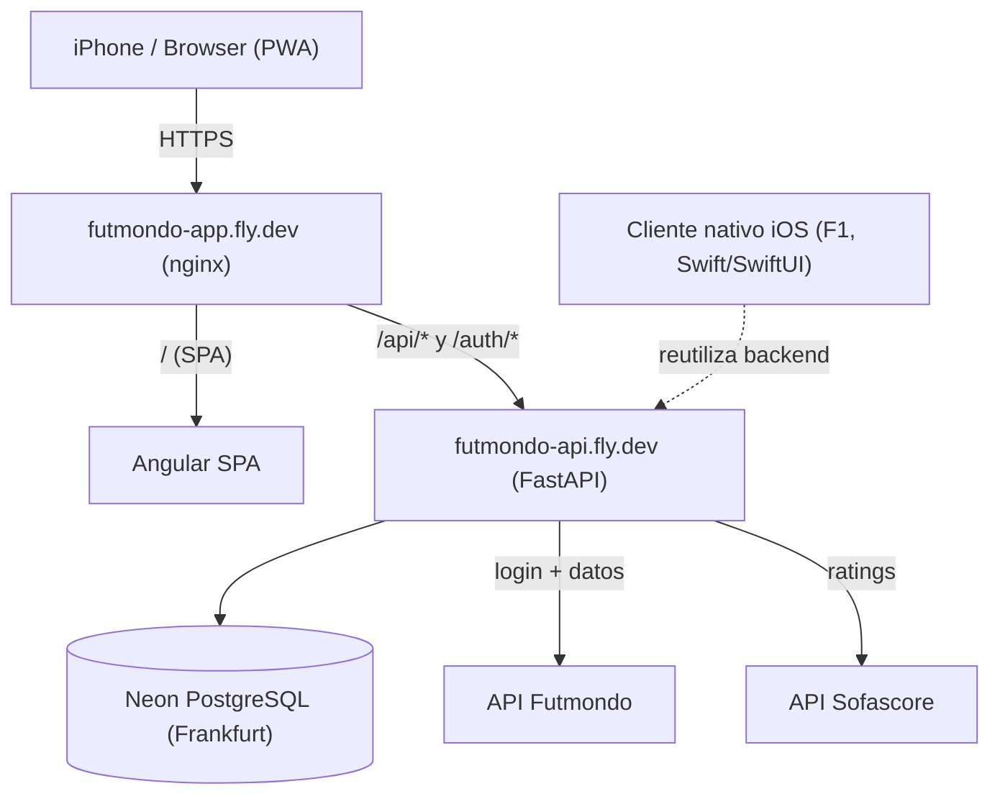

# Architecture — Futmondo Analytics

## Visión general

Sistema brownfield de tres capas desplegado en Fly.io, con una PWA Angular
servida por nginx que habla con un backend FastAPI, que persiste en Neon
PostgreSQL y se integra con dos APIs externas (Futmondo y Sofascore).

- **Frontend**: Angular 22 + Material 22 (standalone components, signals, PWA).
  Servido por nginx (`angular-app/nginx.prod.conf`, `Dockerfile`), app Fly.io
  `futmondo-app`.
- **Backend**: FastAPI (Python 3.12), app Fly.io `futmondo-api`, puerto `8000`,
  healthcheck `/health`.
- **Base de datos**: Neon PostgreSQL (serverless, Frankfurt / tier free). El
  único engine soportado en producción es PostgreSQL vía `DATABASE_URL`
  (`config.py`); existe una ruta SQLite para tests/local (`db_connection.py`,
  `db.db_type`).
- **Integraciones externas**: API Futmondo (`FutmondoClient`, `requests`) y API
  Sofascore (`SofascoreClient`, documentado con `curl_cffi` en el stack).

## Diagrama de producción (mermaid)

Fallback de texto del diagrama: el iPhone o navegador habla por HTTPS con
`futmondo-app.fly.dev` (nginx), que sirve la SPA Angular en `/` y hace de proxy
de `/api/*` y `/auth/*` hacia `futmondo-api.fly.dev` (FastAPI). FastAPI persiste
en Neon PostgreSQL (Frankfurt) y se integra con la API de Futmondo (login +
datos) y la de Sofascore (ratings). El cliente nativo iOS de F1 (línea
discontinua) reutiliza el mismo backend FastAPI.

## Modelo de autenticación (clave para F1)

- **Access token (JWT, HS256, 1h)**: emitido por `create_access_token`
  (`jwt_utils.py`), vive **en memoria** del cliente (en el frontend Angular,
  `AuthService.accessToken`, nunca en `localStorage`). Se envía como
  `Authorization: Bearer <token>` en cada `/api/v1/*`.
- **Refresh token (JWT, HS256, 30 días)**: emitido por `create_refresh_token`;
  su hash se persiste en `refresh_tokens` para permitir revocación. Hoy se
  entrega **solo** como cookie `HttpOnly` (`_set_refresh_cookie`, nombre
  `futmondo_refresh_token`, `path="/auth"`, `secure` según `COOKIE_SECURE`,
  `samesite=lax`). **No** existe hoy ningún transporte del refresh token por body
  o header — ese es el ajuste aditivo D-01 que F1 necesita para iOS.
- **Validación de `/api/v1/*`**: una `AuthMiddleware` (Starlette
  `BaseHTTPMiddleware` en `main.py`) exige `Authorization: Bearer` y valida el
  access token con `verify_token(..., expected_type="access")`; rutas en
  `AUTH_EXCLUDED_PATHS` (`/auth/login`, `/auth/refresh`, `/auth/logout`,
  `/health`, `/`, `/docs`, `/openapi.json`, `/redoc`) quedan exentas. Existe
  además la dependencia `get_current_user` (`dependencies.py`) con la misma
  lógica para endpoints que la usan explícitamente.
- **Sesión Futmondo por usuario**: tras el login, `SessionStore`
  (`session_store.py`) cachea en memoria un `FutmondoClient` autenticado (TTL 12h)
  usado por los endpoints de datos. La contraseña **nunca** se retiene en memoria;
  la rehidratación tras reinicio usa un handle de credencial cifrado
  (`FUTMONDO_CRED_KEY`, `session_service.py`, `credential_protection.py`),
  guardado de forma durable (`SessionRepository`).

## Flujo de petición

1. El navegador/PWA llama a `/auth/login` → recibe `access_token` (JSON) y la
   cookie `HttpOnly` del refresh.
2. El `authInterceptor` del frontend añade `Authorization: Bearer` a las
   llamadas `/api/v1/*` y `withCredentials` a las `/auth/*`.
3. Ante un `401`, el interceptor llama a `/auth/refresh` (cookie) para obtener un
   nuevo access token y reintenta; ante `403` fuerza logout.
4. `AuthMiddleware` valida el Bearer antes de llegar al router del endpoint.

## Despliegue y CORS

- Dos apps Fly.io: `futmondo-api` (backend) y `futmondo-app` (frontend nginx).
- `CORSMiddleware` con whitelist explícita (`https://futmondo-app.fly.dev`,
  `http://futmondo.localhost`, `http://localhost:4200`, `http://localhost:3000`)
  y `allow_credentials=True` (necesario para la cookie de refresh). Hay override
  por `EXTRA_CORS_ORIGIN`. **Nota F1**: un origen nativo iOS no está en la
  whitelist; si el cliente nativo usa cookies necesitaría ajuste CORS, pero D-01
  (transporte del refresh fuera de cookie) evita la dependencia de CORS+cookies.
- Arranque idempotente: `init_auth_tables`, `ensure_durable_session_schema`,
  `ensure_durable_task_schema` + barrido de tareas interrumpidas; los fallos
  transitorios degradan a warning y no tumban el proceso (FR3.2.2/BR1.6).

## Sources

- `backend/app/main.py`
- `backend/app/auth/routes.py`
- `backend/app/auth/jwt_utils.py`
- `backend/app/auth/dependencies.py`
- `backend/app/auth/session_store.py`
- `backend/app/services/integration_errors.py`
- `backend/app/core/config.py`
- `angular-app/src/app/core/services/auth.service.ts`
- `angular-app/src/app/core/interceptors/auth.interceptor.ts`
- `README.md`, `angular-app/nginx.prod.conf` (referenciado), `fly.toml`

## Assumptions & Open Questions

- La región exacta (`cdg` en los `fly.toml` vs "París/Frankfurt" en prosa del
  `README.md`) no se verificó abriendo cada `fly.toml`; se reporta como aparece
  en `README.md`. La topología (dos apps + Neon) sí está respaldada por los
  workflows y el `README.md`.
