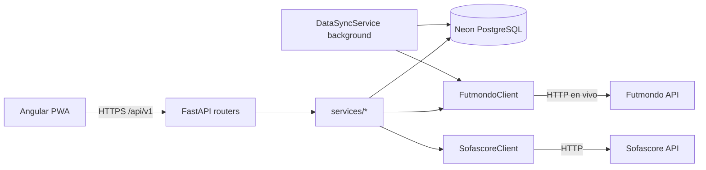
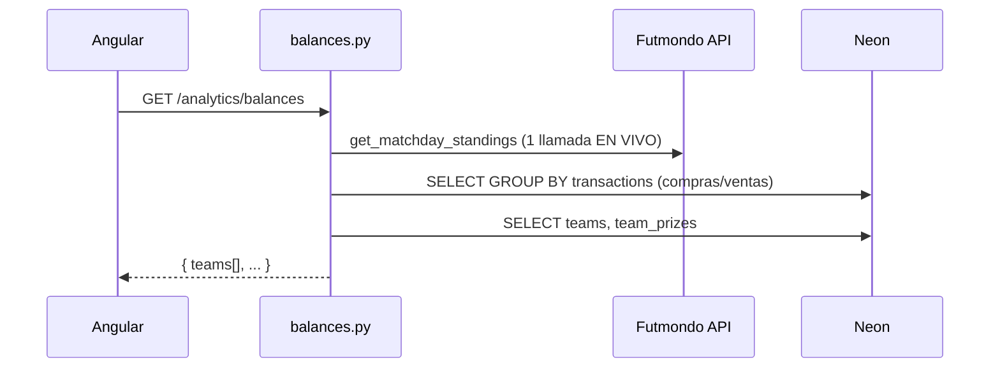
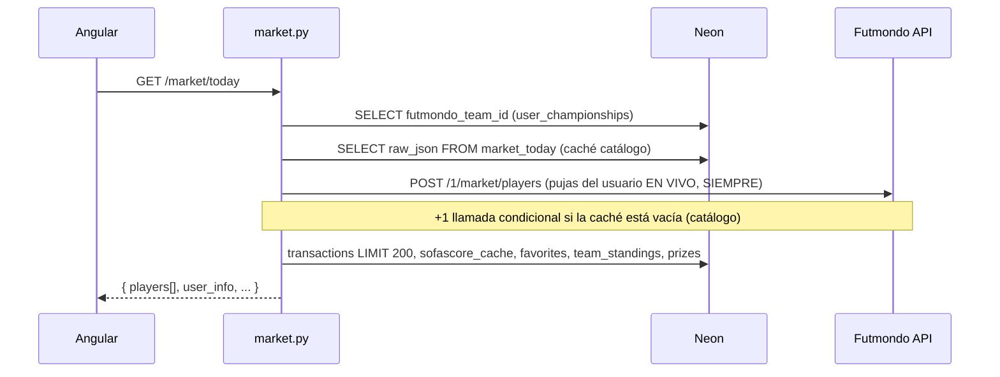
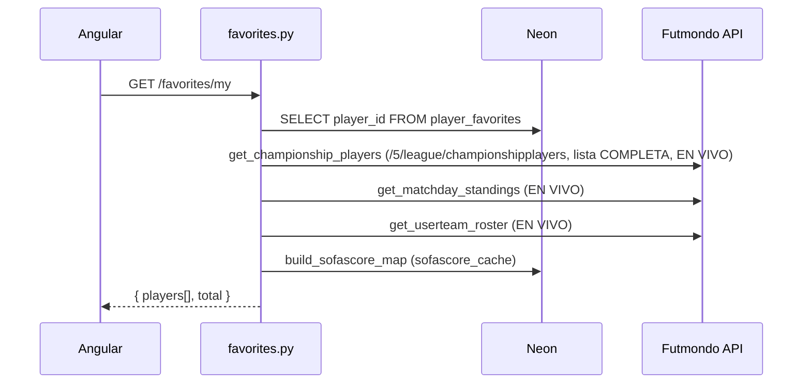

# Architecture — Futmondo Analytics

> Refresco enfocado en latencia. Prosa previa preservada; se añaden los
> **Interaction Diagrams** del camino de petición de los 3 endpoints del intent.

## System Overview

PWA Angular (frontend) + FastAPI (backend Python) + Neon PostgreSQL. El backend
actúa de **proxy/caché** sobre la API de Futmondo (y la API de Sofascore para
ratings). Un proceso de **sync en background** pre-sincroniza datos de Futmondo
a Neon; los endpoints de lectura sirven desde Neon cuando el dato está
sincronizado, y caen a llamadas EN VIVO a Futmondo cuando no.

## Architectural Style

Monolito modular por capas: routers FastAPI (`api/v1/endpoints/`) → servicios
(`services/`) → acceso a datos (`db_connection` + SQL-en-router heredado + capa
DDD parcial en `services/sync/` y `data_manager/`). Integraciones externas
encapsuladas en `FutmondoClient` y `SofascoreClient`, con errores tipados
(`integration_errors`).

## Component Relationships

Texto fallback: el frontend Angular llama al backend FastAPI por `/api/v1/*`.
Los routers delegan en `services/*`, que leen/escriben Neon y, cuando falta el
dato, llaman en vivo a Futmondo (`FutmondoClient`) o Sofascore
(`SofascoreClient`). `DataSyncService` (background) rellena Neon desde Futmondo.

## Data Flow — lectura rápida vs lenta

- **Rápida** (`balances`): lee datos pre-sincronizados de Neon
  (`transactions`, `team_prizes`, `teams`) + 1 llamada en vivo (standings).
- **Lenta** (`market/today`, `favorites/my`): hace 1-3 llamadas en vivo a
  Futmondo por request; el tiempo es dominado por esos round-trips HTTP
  (`timeout=15 s` por llamada en `FutmondoClient._make_request`).

## Key Design Decisions

- Backend como caché/proxy: `market_today` cachea el catálogo del día;
  standings/teamValue se leen de `team_standings`.
- Las **pujas del usuario** NO se cachean (privacidad entre usuarios), por eso
  `/market/today` siempre hace 1 llamada en vivo.
- SQL-en-router es deuda heredada (NO ampliar); los god-files
  (`data_sync_service.py`, `data_manager_v2.py`) tampoco (ver
  `code-quality-assessment.md`).

## Improvement Opportunities

- Leer el catálogo de jugadores desde Neon (`players`/`player_championship_stats`)
  en `/favorites/my` para eliminar `get_championship_players` en vivo.
- Evaluar caché de pujas del usuario con invalidación tras `bid`/`cancelbid`.
- Cualquier lector read-from-sync debe ir tras una capa/función estrecha
  testeable, nunca ampliando los god-files ni el SQL-en-router.

## Interaction Diagrams

### `GET /api/v1/analytics/balances` (~0.4 s — rápido)

Texto fallback: 1 llamada en vivo (standings → teamValue) + lecturas agregadas
de Neno (`transactions`, `teams`, `team_prizes`). Rápido.

### `GET /api/v1/market/today` (~1.6 s)

Texto fallback: lee caché `market_today`; hace SIEMPRE 1 llamada en vivo
`/1/market/players` para las pujas del usuario (+1 condicional si no hay caché);
resto son lecturas agregadas de Neon.

### `GET /api/v1/favorites/my` (~3.4 s — el más lento)

Texto fallback: 1 SELECT barato de favoritos, luego **2-3 llamadas en vivo
encadenadas** a Futmondo (la peor, `get_championship_players`, descarga la lista
completa de jugadores solo para filtrar favoritos). Enriquecimiento Sofascore
desde caché. Sin camino read-from-sync hoy → el más lento.
