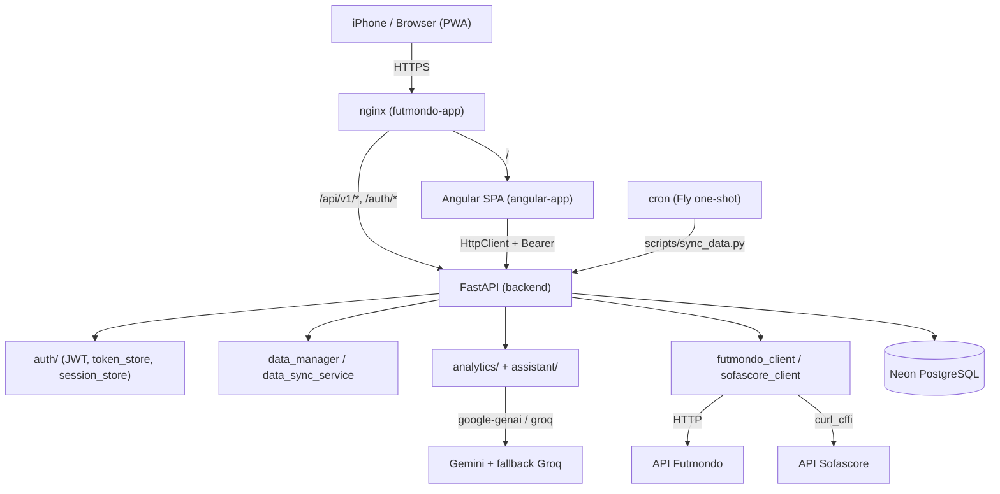
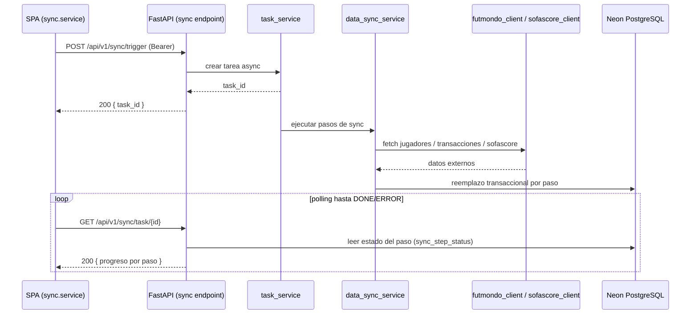

# Architecture — futmondo-analytics

## System Overview

Sistema de dos builds independientes acoplados por un contrato HTTP:

- **Frontend** `angular-app` (SPA/PWA, Angular 22 + Material 22), servido por
  nginx. Consume `/api/v1/*` y `/auth/*`.
- **Backend** `backend` (FastAPI, Python 3.12): autenticación JWT, sincronización
  con Futmondo/Sofascore, cálculo de premios/finanzas, asistente LLM y servir
  fotos. Persiste en **Neon PostgreSQL** (Frankfurt).
- Dos piezas de despliegue auxiliares: `proxy` (nginx reverse proxy sólo para
  `docker-compose` local) y `cron` (app Fly.io one-shot que ejecuta
  `scripts/sync_data.py` y sale, compartiendo el Dockerfile del backend).

No hay monorepo tooling (ni workspaces npm ni Nx): son dos builds separados
unidos por el contrato HTTP `/api/v1/*` + `/auth/*`.

## Architectural Style

**Monolito modular desplegado como dos servicios** (frontend estático + API
monolítica), con **descomposición DDD parcial** dentro del backend. Evidencia:
`backend/app/services/` contiene tanto god-files heredados como paquetes
`data_manager/<resp>/{domain,application,infrastructure}`, `sync/*`,
`analytics/`, `assistant/` ya extraídos en intents previos. No es microservicios
(un único proceso FastAPI monta todos los routers en `main.py`); no es
serverless (uvicorn long-running en Fly.io). Patrón heredado a vigilar:
**SQL-en-router** (17 ficheros de `api/v1/endpoints/` ejecutan SQL directo),
acoplando persistencia y capa HTTP. Ver inventario en `component-inventory.md` y
deuda en `code-quality-assessment.md`.

## Component Relationships



Texto de respaldo (fallback): el navegador llega por HTTPS a nginx
`futmondo-app`, que sirve la SPA Angular en `/` y hace proxy de `/api/v1/*` y
`/auth/*` al backend FastAPI. La SPA llama al backend vía `HttpClient` con token
Bearer. El backend se apoya en `auth/` (JWT), `data_manager`/`data_sync_service`,
`analytics/`+`assistant/`, y los clientes `futmondo_client`/`sofascore_client`,
persistiendo en Neon PostgreSQL. Los clientes consumen las APIs externas
Futmondo y Sofascore (ésta vía `curl_cffi`); el asistente llama a Gemini con
fallback a Groq. La app `cron` one-shot ejecuta la sincronización programada.

## Data Flow

1. **Login**: SPA → `/auth/login` → backend valida contra API Futmondo → emite
   JWT access (1h, en memoria) + refresh (30d, cookie HttpOnly).
2. **Lectura analítica**: SPA (Bearer) → `/api/v1/*` → servicios → consulta Neon
   (a veces SQL-en-router) → respuesta JSON.
3. **Sync asíncrono**: SPA → `/api/v1/sync/trigger` (devuelve `task_id`) →
   `task_service` orquesta pasos (`data_sync_service` + clientes externos) →
   escribe en Neon; SPA hace polling `/api/v1/sync/task/{id}`.
4. **Asistente**: SPA → `/api/v1/assistant/*` → `assistant/` compone contexto →
   `llm_adapter` (Gemini/Groq) → markdown de vuelta.

## Interaction Diagrams

Transacción de negocio «**Sincronización de datos del campeonato**» (async con
polling), que atraviesa SPA, API, servicio de tareas, servicios de sync,
clientes externos y base de datos:



Transacción «**Login + refresh de sesión**» (modelo de sesión cookie-based,
riesgo de portabilidad nativa #1):

```mermaid
sequenceDiagram
  participant U as SPA (auth.service + authInterceptor)
  participant A as FastAPI (/auth)
  participant F as API Futmondo
  U->>A: POST /auth/login (email/password)
  A->>F: validar credenciales
  F-->>A: OK + sesión Futmondo
  A-->>U: access JWT (body, 1h) + refresh (Set-Cookie HttpOnly, 30d)
  Note over U,A: access vive en memoria; refresh en cookie
  U->>A: GET /api/v1/* (Authorization: Bearer)
  A-->>U: 401 cuando el access caduca
  U->>A: POST /auth/refresh (cookie, withCredentials)
  A-->>U: nuevo access JWT (reintenta la cola de peticiones)
```

Texto de respaldo (fallback) del flujo de sync: la SPA dispara el trigger, el
backend crea una tarea y devuelve `task_id`; la tarea ejecuta los pasos de sync
que llaman a los clientes externos y escriben en Neon por reemplazo
transaccional por paso; la SPA hace polling del estado hasta DONE/ERROR. Del
flujo de login: la SPA envía credenciales, el backend valida contra Futmondo y
responde con access JWT en el cuerpo (memoria) y refresh en cookie HttpOnly; en
401 la SPA llama a `/auth/refresh` con la cookie y reintenta.

## Key Design Decisions

- **Backend como capa de dominio reutilizable**: toda la lógica (premios,
  finanzas, sync, auth, asistente) vive en FastAPI; el frontend es presentación.
  Implicación para el intent: migrar a nativo es **reemplazo de la capa de
  presentación**, no un rewrite del backend (consumiría el mismo contrato,
  59 operaciones).
- **Sesión híbrida access-en-memoria + refresh-en-cookie-HttpOnly**: segura en
  web, pero cookie-based → riesgo de portabilidad nativa (ver riesgos en
  `code-quality-assessment.md`).
- **Descomposición DDD incremental**: god-files se van extrayendo a paquetes
  `domain/application/infrastructure` manteniendo facades byte-for-byte.
- **Despliegue acoplado por `needs:`**: `verify → deploy-backend →
  deploy-frontend → smoke-test(/health)` en `fly-deploy.yml`.

## Improvement Opportunities

- Retirar el patrón **SQL-en-router** (17 ficheros) hacia la capa de servicios
  DDD ya existente.
- Eliminar el **dead-ish code** multi-engine (`adapt_params()` `? → %s`,
  ramas `db_type != postgres`, `DATABASE_PATH`), herencia del soporte
  SQLite/Turso retirado.
- Completar la descomposición de los god-files restantes (ver tamaños medidos en
  `code-quality-assessment.md`).
