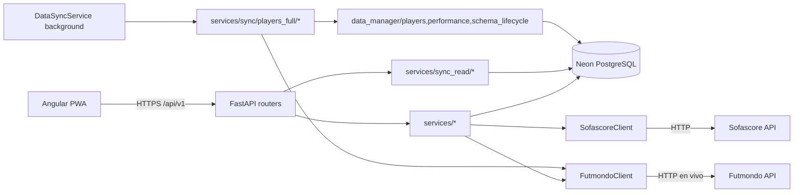
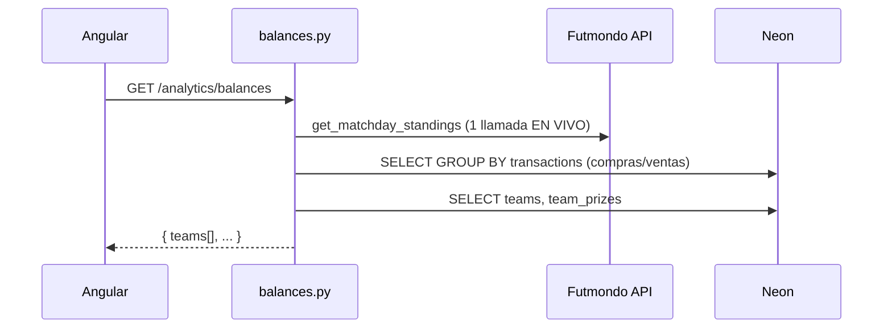
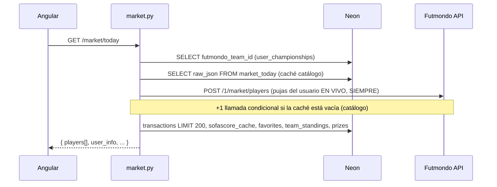
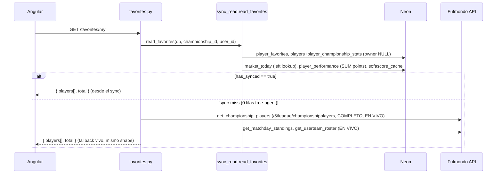

# Architecture — Futmondo Analytics

> Merge CURRENT. Prosa previa (latencia) **preservada**; se añade el **flujo de
> datos de `sync_players_full`** (escritura) y la capa `services/sync_read/`
> (lectura), más el gap de campos del intent `261023-sync-jugador-completo`.

## System Overview

PWA Angular (frontend) + FastAPI (backend Python) + Neon PostgreSQL. El backend
actúa de **proxy/caché** sobre la API de Futmondo (y la API de Sofascore para
ratings). Un proceso de **sync en background** pre-sincroniza datos de Futmondo
a Neon; los endpoints de lectura sirven desde Neon cuando el dato está
sincronizado, y caen a llamadas EN VIVO a Futmondo cuando no.

## Architectural Style

Monolito modular por capas: routers FastAPI (`api/v1/endpoints/`) → servicios
(`services/`) → acceso a datos (`db_connection` + SQL-en-router heredado + capa
DDD parcial en `services/sync/` y `data_manager/`). Integraciones externas
encapsuladas en `FutmondoClient` y `SofascoreClient`, con errores tipados
(`integration_errors`).

El sync de jugadores y los adapters de datos siguen un patrón **hexagonal/DDD
por responsabilidad**: `domain/ports.py` (Protocol estructural, sin SQL) +
`infrastructure/*_adapter.py` (único con SQL, delega verbatim al god-file
`DataManagerV2`) + un orquestador/servicio fino. Así se extrae comportamiento de
los god-files sin reescribirlo.

## Component Relationships



Texto fallback: el frontend Angular llama al backend FastAPI por `/api/v1/*`.
Los routers delegan en `services/*` o en la capa narrow `services/sync_read/*`
(lectura desde Neon). `DataSyncService` (background) invoca los orquestadores
`services/sync/*` (p. ej. `players_full`), que leen de Futmondo
(`FutmondoClient`) y escriben Neon vía los adapters DDD de `data_manager/*`.

## Data Flow — lectura rápida vs lenta

- **Rápida** (`balances`): lee datos pre-sincronizados de Neon
  (`transactions`, `team_prizes`, `teams`) + 1 llamada en vivo (standings).
- **Lenta** (`market/today`, `favorites/my`): hace 1-3 llamadas en vivo a
  Futmondo por request cuando el dato no está en el sync; el tiempo es dominado
  por esos round-trips HTTP (`timeout=15 s` por llamada en
  `FutmondoClient._make_request`).

## Data Flow — sync completo de jugadores (`sync_players_full`)

`DataSyncService.sync_players_full` → `PlayersFullSyncOrchestrator.sync()`
(`backend/app/services/sync/players_full/orchestrator.py`):

1. Lee el objeto vivo `client.get_championship_players(championship_id)`
   (`/5/league/championshipplayers`, `{players:[...]}`).
2. Por jugador extrae `name, role, role2, teamId, team, slug, photo, value` y,
   de sub-objetos, `clause{price,suggestedClause,date}` y
   `average{averageLastFive,average}`, más `userteam*`/`fav`.
3. Persiste vía el `PlayersFullSyncDataPort` (adapter → `DataManagerV2`):
   - `save_players_batch` → tabla **`players`**
     (`name,role,role2,real_team_id,real_team_name,slug,photo_url,value`).
   - `save_player_championship_stats` → **`player_championship_stats`**
     (owner\*, `clause_price,suggested_clause,average_last_five,average_overall,
     clause_date`).
   - `delete_orphan_players` (limpieza `DELETE ... NOT IN` + sin historial).
   - `save_favorites` → **`player_favorites`** (SQL crudo en el adapter).
   - `update_sync_metadata` → **`sync_metadata`** (`data_type='players'`).

**Campos que el sync NO persiste** (gap del intent): `points`, `change`,
`home_average`, `away_average`, `matches`, `team_logo`. Hoy esos campos solo
existen en:
- **`player_performance`** — `points` por jornada×equipo (vacío para agentes
  libres → SUM=0).
- **`market_today`** — `change`, medias detalladas, `matches`, `team_logo`,
  `team`, `points` para ~30 jugadores del día (poblado por
  `assistant_service._save_market_to_db`, no por `sync_players_full`).

## Capa de lectura `services/sync_read/`

Capa narrow read-from-sync (todo el SQL nuevo vive aquí, nunca en routers ni
god-files):
- `read_favorites(db, championship_id, user_id)` → favoritos agentes libres
  desde `player_championship_stats`+`players` (owner NULL = agente libre),
  enriquecidos con `market_today` (left lookup por `player_id`+fecha de hoy) y
  `player_performance` (SUM points), más Sofascore. Devuelve `(players,
  has_synced)`; `has_synced=False` dispara el fallback en vivo
  (`_get_favorites_live`). Contrato byte-for-byte con la ruta viva.
- `read_market_catalog` (lee `market_today.raw_json`) y `available_for_bids`
  (derivación pura) para `market/today`.

El límite actual es de **escritura**, no de lectura: `read_favorites` ya lee del
sync lo que existe, pero para un agente libre fuera del mercado del día el
left-lookup a `market_today` no encuentra nada y devuelve defaults
(`change=0`, medias `None`, `matches=0`, `team_logo=''`). Enriquecer
`sync_players_full` elimina esa dependencia.

## Key Design Decisions

- Backend como caché/proxy: `market_today` cachea el catálogo del día;
  standings/teamValue se leen de `team_standings`.
- Las **pujas del usuario** NO se cachean (privacidad entre usuarios), por eso
  `/market/today` siempre hace 1 llamada en vivo.
- SQL-en-router es deuda heredada (NO ampliar); los god-files
  (`data_sync_service.py`, `data_manager_v2.py`) tampoco. El comportamiento se
  extrae a adapters DDD (`data_manager/*`) que delegan verbatim.

## Improvement Opportunities

- **Enriquecer `sync_players_full`** para persistir `points/change/home_average/
  away_average/matches/team_logo` por jugador (nueva(s) columna(s) en
  `players`/`player_championship_stats` o tabla de stats más rica vía
  `schema_lifecycle` + re-sync), de modo que `read_favorites`/`market_read`
  dejen de depender de `market_today`/vivo.
- Leer el catálogo de jugadores desde Neon en `/favorites/my` para eliminar
  `get_championship_players` en vivo (ya hay fast-path; completarlo con los
  campos enriquecidos).
- Cualquier lector/escritor nuevo va tras una capa/función estrecha testeable,
  nunca ampliando los god-files ni el SQL-en-router.

## Interaction Diagrams

### `GET /api/v1/analytics/balances` (~0.4 s — rápido)



Texto fallback: 1 llamada en vivo (standings → teamValue) + lecturas agregadas
de Neon (`transactions`, `teams`, `team_prizes`). Rápido.

### `GET /api/v1/market/today` (~1.6 s)



Texto fallback: lee caché `market_today`; hace SIEMPRE 1 llamada en vivo
`/1/market/players` para las pujas del usuario (+1 condicional si no hay caché);
resto son lecturas agregadas de Neon.

### `GET /api/v1/favorites/my` (fast-path sync / fallback vivo)



Texto fallback: `get_my_favorites` intenta primero `read_favorites` (desde el
sync); si no hay filas sincronizadas de agentes libres (sync-miss) cae al
`_get_favorites_live` pre-refactor (descarga el catálogo completo en vivo y lee
`change/points/home/away/matches/logo` del objeto por jugador). El shape de la
respuesta es idéntico en ambas rutas.

### Flujo de escritura `sync_players_full` (background)

```mermaid
sequenceDiagram
  participant SYNC as DataSyncService
  participant ORCH as PlayersFullSyncOrchestrator
  participant FUT as Futmondo API
  participant DMP as data_manager/players (adapter)
  participant DB as Neon
  SYNC->>ORCH: sync_players_full()
  ORCH->>FUT: get_championship_players (/5/league/championshipplayers)
  ORCH->>DMP: save_players_batch → players (sin points/change/logo/medias-detalle)
  ORCH->>DMP: save_player_championship_stats → player_championship_stats
  ORCH->>DMP: delete_orphan_players (NOT IN + sin historial)
  ORCH->>DB: save_favorites → player_favorites; update_sync_metadata
```

Texto fallback: `sync_players_full` lee el catálogo vivo y persiste un
subconjunto de campos a `players`/`player_championship_stats`/`player_favorites`;
**no** persiste points/change/logo/medias-detalle, que quedan solo en
`player_performance`/`market_today`.
