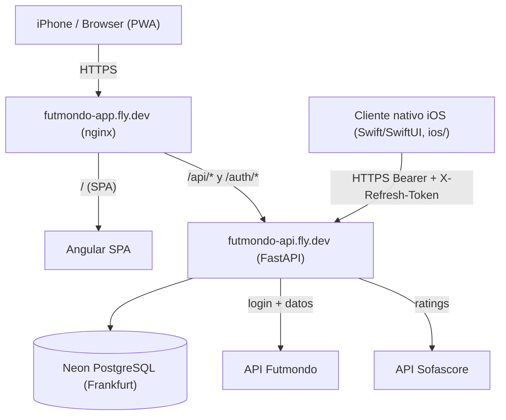

# Architecture — Futmondo Analytics

## Visión general

Sistema brownfield de tres capas desplegado en Fly.io, con una PWA Angular
servida por nginx que habla con un backend FastAPI, que persiste en Neon
PostgreSQL y se integra con dos APIs externas (Futmondo y Sofascore).

- **Frontend**: Angular 22 + Material 22 (standalone components, signals, PWA).
  Servido por nginx (`angular-app/nginx.prod.conf`, `Dockerfile`), app Fly.io
  `futmondo-app`.
- **Backend**: FastAPI (Python 3.12), app Fly.io `futmondo-api`, puerto `8000`,
  healthcheck `/health`.
- **Base de datos**: Neon PostgreSQL (serverless, Frankfurt / tier free). El
  único engine soportado en producción es PostgreSQL vía `DATABASE_URL`
  (`config.py`); existe una ruta SQLite para tests/local (`db_connection.py`,
  `db.db_type`).
- **Integraciones externas**: API Futmondo (`FutmondoClient`, `requests`) y API
  Sofascore (`SofascoreClient`, documentado con `curl_cffi` en el stack).

## Diagrama de producción (mermaid)

Fallback de texto del diagrama: el iPhone o navegador habla por HTTPS con
`futmondo-app.fly.dev` (nginx), que sirve la SPA Angular en `/` y hace de proxy
de `/api/*` y `/auth/*` hacia `futmondo-api.fly.dev` (FastAPI). FastAPI persiste
en Neon PostgreSQL (Frankfurt) y se integra con la API de Futmondo (login +
datos) y la de Sofascore (ratings). El cliente nativo iOS (`ios/`, Swift/SwiftUI,
añadido por F1) llama directamente al backend FastAPI por HTTPS, enviando el
access token JWT como `Authorization: Bearer` y el refresh token en el header
`X-Refresh-Token`.

## Modelo de autenticación (clave para F1)

- **Access token (JWT, HS256, 1h)**: emitido por `create_access_token`
  (`jwt_utils.py`), vive **en memoria** del cliente (en el frontend Angular,
  `AuthService.accessToken`, nunca en `localStorage`). Se envía como
  `Authorization: Bearer <token>` en cada `/api/v1/*`.
- **Refresh token (JWT, HS256, 30 días)**: emitido por `create_refresh_token`;
  su hash se persiste en `refresh_tokens` para permitir revocación. Hoy se
  entrega **solo** como cookie `HttpOnly` (`_set_refresh_cookie`, nombre
  `futmondo_refresh_token`, `path="/auth"`, `secure` según `COOKIE_SECURE`,
  `samesite=lax`). **No** existe hoy ningún transporte del refresh token por body
  o header — ese es el ajuste aditivo D-01 que F1 necesita para iOS.
- **Validación de `/api/v1/*`**: una `AuthMiddleware` (Starlette
  `BaseHTTPMiddleware` en `main.py`) exige `Authorization: Bearer` y valida el
  access token con `verify_token(..., expected_type="access")`; rutas en
  `AUTH_EXCLUDED_PATHS` (`/auth/login`, `/auth/refresh`, `/auth/logout`,
  `/health`, `/`, `/docs`, `/openapi.json`, `/redoc`) quedan exentas. Existe
  además la dependencia `get_current_user` (`dependencies.py`) con la misma
  lógica para endpoints que la usan explícitamente.
- **Sesión Futmondo por usuario**: tras el login, `SessionStore`
  (`session_store.py`) cachea en memoria un `FutmondoClient` autenticado (TTL 12h)
  usado por los endpoints de datos. La contraseña **nunca** se retiene en memoria;
  la rehidratación tras reinicio usa un handle de credencial cifrado
  (`FUTMONDO_CRED_KEY`, `session_service.py`, `credential_protection.py`),
  guardado de forma durable (`SessionRepository`).

## Flujo de petición

1. El navegador/PWA llama a `/auth/login` → recibe `access_token` (JSON) y la
   cookie `HttpOnly` del refresh.
2. El `authInterceptor` del frontend añade `Authorization: Bearer` a las
   llamadas `/api/v1/*` y `withCredentials` a las `/auth/*`.
3. Ante un `401`, el interceptor llama a `/auth/refresh` (cookie) para obtener un
   nuevo access token y reintenta; ante `403` fuerza logout.
4. `AuthMiddleware` valida el Bearer antes de llegar al router del endpoint.

## Cliente nativo iOS (`ios/`, Swift/SwiftUI — añadido por F1)

Cuarto componente del sistema, introducido por el intent F1
`261018-design-system-nativo`: un cliente nativo iOS que **reutiliza el backend
FastAPI** sin cambiar la lógica de negocio. Paquete SwiftPM con Apple SDK
únicamente (cero dependencias externas). Capas:

- **`FutmondoKit` (library)** — lógica testeable y device-independent:
  - *Networking*: `NetworkClient` (protocolo `Sendable`, `send` async →
    `Result<T, NetworkError>`, nunca lanza) y `URLSessionNetworkClient` sobre
    `URLSession`. Su `init` es throwing y **rechaza cualquier base URL no-https**
    (SEC-N1); inyecta `Authorization: Bearer` por request leyendo un provider
    síncrono; mapea el status HTTP a un `NetworkError` tipado y nunca filtra
    credenciales.
  - *Auth*: `AuthService` es un **`actor`** que posee el access token en memoria
    y orquesta `login` / `refresh` / `bootstrap` / `logout`. El refresh está
    **coalescido** (una sola tarea in-flight compartida por llamadores
    concurrentes). El refresh token se guarda en **Keychain**
    (`KeychainTokenStore`, servicio `com.futmondo.app.auth`,
    `kSecAttrAccessibleAfterFirstUnlockThisDeviceOnly`) y se envía al backend en
    el header **`X-Refresh-Token`** (consumo del ajuste aditivo D-01). El puente
    `TokenHolder` (snapshot `Sendable` con `NSLock`) da al `NetworkClient` un
    provider síncrono sin entrar en el actor. `LogoutFlagStore` persiste solo un
    booleano "logout pendiente" (nunca el refresh token).
  - *DesignSystem base (SwiftUI-free)*: tokens de color (`DSColorToken` /
    `DSColorValue`, light/dark reproduciendo Material 3), escala tipográfica
    (`DSTypographyScale` h1/h2/h3/body), espaciado (`DSSpacing`) y
    `ContrastRatio` (validación WCAG AA). Pura por diseño para ser testeable en
    Linux/WSL.
- **`FutmondoApp` (app product, SwiftUI)** — shell de UI bajo
  `#if canImport(SwiftUI)`: `@main FutmondoApp` cablea el grafo
  (`KeychainTokenStore` + `TokenHolder` + `URLSessionNetworkClient` +
  `AuthService`) con base `https://futmondo-api.fly.dev` y arranca en
  `SplashView` (auto-login vía `bootstrap()`, nunca cuelga). `LoginView` +
  `AuthViewModel` (`@Observable`) replican el flujo de login; los accesores
  SwiftUI del DesignSystem (`DSColor`/`DSFont`/`DSSpacingSwiftUI`) y los
  componentes (`PrimaryButton`, `TextInputField`, `Card`/`LoadingState`/
  `ErrorState`) reproducen el tema Angular, más un `CatalogView` de desarrollo.

Contraste con el frontend web: donde el navegador recibe el refresh token por
cookie `HttpOnly`, el cliente nativo lo recibe en el body de `/auth/login`
(`refresh_token`) y lo reenvía en el header `X-Refresh-Token` a `/auth/refresh`
y `/auth/logout` (D-01). El access token vive en memoria en ambos clientes; en
iOS nunca se persiste y el refresh token solo vive en Keychain. **F2 construirá
sobre esta capa** el cliente de datos de Presupuesto/championships.

## Arquitectura de theming del frontend (fuente de verdad del diseño nativo)

El frontend Angular centraliza su tema en una capa de estilos global que es la
**fuente de verdad del sistema de diseño** a reproducir en la app nativa iOS.

- **Tema Material 3 global** — `angular-app/src/styles.scss` aplica
  `@include mat.theme(...)` sobre `html`:
  - `color.primary: mat.$green-palette` (identidad **verde**),
    `color.tertiary: mat.$violet-palette` (acento **violeta**).
  - `typography: Roboto`, `density: 0`.
  - Genera los tokens de sistema `--mat-sys-*` (p. ej. `--mat-sys-surface`,
    `--mat-sys-on-surface`, `--mat-sys-on-surface-variant`,
    `--mat-sys-surface-container-lowest/high/highest`, `--mat-sys-outline-variant`,
    `--mat-sys-primary`) que el resto de componentes consumen.
- **Tokens semánticos propios** (sección `// ===== DESIGN SYSTEM TOKENS =====`):
  - Color de dinero: `.money-positive` `#2e7d32` (claro) / `#66bb6a` (oscuro);
    `.money-negative` `#d32f2f` (claro) / `#ef5350` (oscuro).
  - Escala tipográfica: `h1` 28px/700, `h2` 20px/600, `h3` 16px/600.
  - Estilos globales de tabla Material (`.mat-mdc-table`).
  - Fondo de splash: `body.splash-bg` con
    `linear-gradient(135deg, #1b5e20 0%, #2e7d32 50%, #43a047 100%)`.
- **Modo claro/oscuro**: Material gestiona el grueso del esquema; los overrides
  custom del modo oscuro se aplican bajo el selector `body.dark-theme`
  (y `.dark-theme &` en partials como `_player-card.scss`).
- **Shell de aplicación** — `angular-app/src/app/app.scss`: sidebar
  (`.app-sidenav`, 250px; mini-mode 64px en tablet), toolbar móvil sticky, estado
  activo de navegación (`.active-link` `#4CAF50` con texto/íconos blancos),
  respeto del notch iPhone (`env(safe-area-inset-top)`), animación `fadeIn` de
  transición de ruta y reglas responsive (<768px, 769–1024px).
- **Partials compartidos** — `angular-app/src/app/shared/styles/`
  (`_table-common.scss`, `_player-card.scss`, `_responsive-grid.scss`,
  `_loading-states.scss`, agregados por `_index.scss`): chips de posición
  (fwd/mid/def/gk), tendencias (up/down/neutral), tarjetas de jugador, grid
  responsive de 1→2→3→4 columnas y estados de carga/error/vacío.
- **Pantalla de referencia (login)** — `features/login/login.component.ts`:
  `mat-card` centrada (max-width 400px, border-radius 16px) sobre el gradiente
  verde de splash; campos `appearance="outline"` con `matPrefix`; botón
  `mat-flat-button color="primary"` full-width con spinner; bloque de error
  (`#ffebee`/`#d32f2f`). Es el patrón concreto de aplicación del tema a reproducir
  en SwiftUI.

El diseño nativo iOS reproduce esta jerarquía (tema global → tokens semánticos →
layout del shell → pantallas) con SDK de Apple (coste 0 €); donde Material 3 no
tenga equivalente 1:1 en SwiftUI, se cubre con Apple HIG.

## Despliegue y CORS

- Dos apps Fly.io: `futmondo-api` (backend) y `futmondo-app` (frontend nginx).
- `CORSMiddleware` con whitelist explícita (`https://futmondo-app.fly.dev`,
  `http://futmondo.localhost`, `http://localhost:4200`, `http://localhost:3000`)
  y `allow_credentials=True` (necesario para la cookie de refresh). Hay override
  por `EXTRA_CORS_ORIGIN`. **Nota F1**: un origen nativo iOS no está en la
  whitelist; si el cliente nativo usa cookies necesitaría ajuste CORS, pero D-01
  (transporte del refresh fuera de cookie) evita la dependencia de CORS+cookies.
- Arranque idempotente: `init_auth_tables`, `ensure_durable_session_schema`,
  `ensure_durable_task_schema` + barrido de tareas interrumpidas; los fallos
  transitorios degradan a warning y no tumban el proceso (FR3.2.2/BR1.6).

## Sources

- `ios/Package.swift`, `ios/xtool.yml`
- `ios/Sources/FutmondoKit/Networking/{NetworkClient,URLSessionNetworkClient}.swift`
- `ios/Sources/FutmondoKit/Auth/{AuthService,KeychainTokenStore,TokenHolder,LogoutFlagStore,Session,AuthDTOs}.swift`
- `ios/Sources/FutmondoApp/{FutmondoApp,SplashView,LoginView,AuthViewModel}.swift`
- `backend/app/main.py`
- `backend/app/auth/routes.py`
- `backend/app/auth/jwt_utils.py`
- `backend/app/auth/dependencies.py`
- `backend/app/auth/session_store.py`
- `backend/app/services/integration_errors.py`
- `backend/app/core/config.py`
- `angular-app/src/app/core/services/auth.service.ts`
- `angular-app/src/app/core/interceptors/auth.interceptor.ts`
- `angular-app/src/styles.scss`, `angular-app/src/app/app.scss`
- `angular-app/src/app/shared/styles/*.scss`, `angular-app/src/app/features/login/login.component.ts`
- `README.md`, `angular-app/nginx.prod.conf` (referenciado), `fly.toml`

## Assumptions & Open Questions

- La región exacta (`cdg` en los `fly.toml` vs "París/Frankfurt" en prosa del
  `README.md`) no se verificó abriendo cada `fly.toml`; se reporta como aparece
  en `README.md`. La topología (dos apps + Neon) sí está respaldada por los
  workflows y el `README.md`.
- El mapeo concreto de tokens `--mat-sys-*` y de densidad Material 3 a primitivas
  SwiftUI es trabajo del intent de diseño; aquí se documenta la arquitectura de
  theming de origen, no su traducción.
