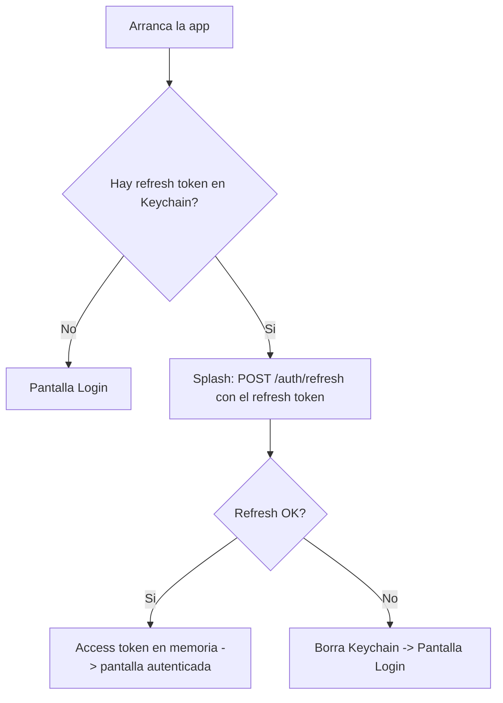
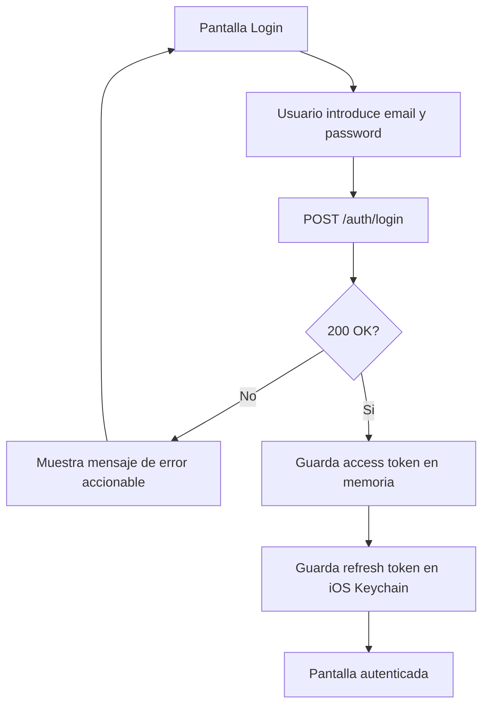
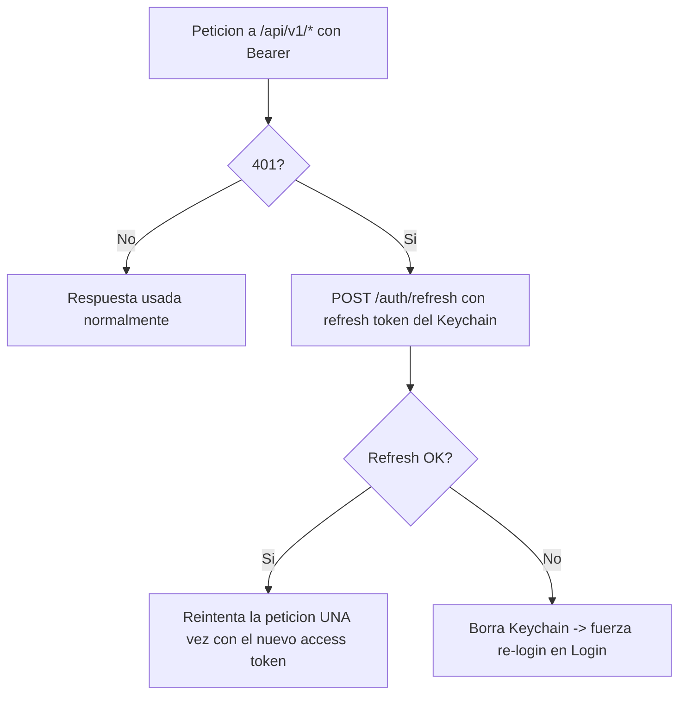
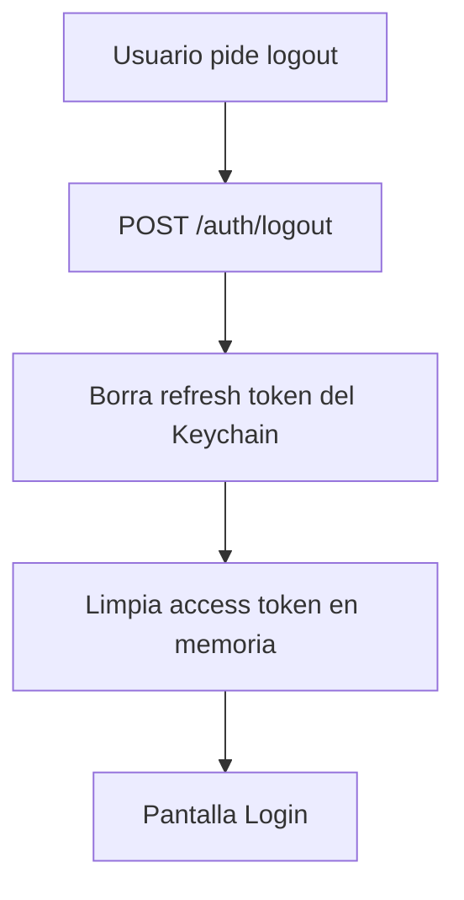

# User Flow — F1: Autenticación nativa (iOS)

> Fase: ideación (rough-mockups). Flujos de usuario de la auth nativa. Idioma: castellano;
> tokens técnicos verbatim en inglés. Diagrama mermaid validado + fallback de texto.

## Flujo 1 — Arranque de la app (auto-login)

Fallback de texto: al arrancar, si no hay refresh token en Keychain → Login. Si lo hay → splash
que llama a `POST /auth/refresh`; si responde OK, guarda el access token en memoria y entra a la
app; si falla, borra el Keychain y va a Login.

## Flujo 2 — Login manual

Fallback de texto: el usuario introduce email/password → `POST /auth/login`. Si no es 200,
muestra error y permanece en Login. Si es 200, guarda el access token en memoria y el refresh
token en Keychain, y entra a la app.

## Flujo 3 — Refresh ante expiración (401)

Fallback de texto: ante un 401 en una llamada protegida, la app refresca con el refresh token
del Keychain; si el refresh va bien, reintenta la petición **una** vez; si falla, borra el
Keychain y fuerza re-login (Q3=A).

## Flujo 4 — Logout

Fallback de texto: el logout llama a `POST /auth/logout` (revoca en backend), borra el refresh
token del Keychain, limpia el access token en memoria y vuelve a Login. Si la llamada de red
falla, igualmente limpia el estado local.

## Sources

- [consumes] intent-statement, scope-document de F1.
- [code] `angular-app/src/app/core/services/auth.service.ts` (flujos de login/refresh/recover/
  logout de referencia).

## Assumptions & Open Questions

None.
