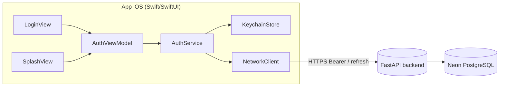

# Domain Design — Componentes (F1: Login nativo end-to-end)

> Fase: inception (domain-design). Perspectiva de arquitectura. Idioma: castellano; tokens
> técnicos verbatim en inglés. Componentes del cliente nativo Swift y del ajuste aditivo del
> backend. Trazabilidad en `traceability.json`.

## Vista general

Texto (fallback): `LoginView`/`SplashView` (SwiftUI) observan `AuthViewModel`, que orquesta
`AuthService`; `AuthService` usa `KeychainStore` (refresh token) y `NetworkClient` (HTTP). El
`NetworkClient` habla con el backend FastAPI por HTTPS (Bearer / refresh). El backend recibe el
ajuste aditivo de transporte del refresh token.

## Componentes del cliente nativo (iOS)

### C1 — `NetworkClient` [FR-7]
Capa HTTP sobre `URLSession`. Responsabilidades: base URL configurable; serialización JSON
(`Codable`); inyección de `Authorization: Bearer <access>`; mapeo de respuestas a `Result`/errores
tipados (`AuthError`, `NetworkError`: `.unauthorized(401)`, `.forbidden(403)`, `.server(5xx)`,
`.transport`). No conoce el Keychain ni la UI.

### C2 — `KeychainStore` [FR-3, NFR-1]
Fachada sobre **Keychain Services** (framework `Security`). Operaciones: `save(refreshToken)`,
`readRefreshToken()`, `delete()`. El refresh token **nunca** sale a `UserDefaults`/plist. Único
punto de acceso al almacén seguro.

### C3 — `AuthService` [FR-1, FR-4, FR-5, FR-6]
Orquesta el ciclo de vida de la sesión: `login(email,password)`, `refresh()`, `logout()`,
`bootstrap()` (auto-login al arrancar). Mantiene el access token **en memoria**. Reglas:
- `login`: `POST /auth/login` → access token (memoria) + refresh token (Keychain vía C2).
- `refresh`: `POST /auth/refresh` enviando el refresh token por body/header (D-01).
- `bootstrap`: si hay refresh token en Keychain, intenta `refresh`; 401/revocado → borra Keychain;
  red/5xx → preserva Keychain.
- `logout`: `POST /auth/logout` (revoca) + borra Keychain + limpia memoria; red caída → limpia
  local + marca **revocación pendiente observable** (ver abajo).
- **Reintento único ante 401 (dueño ÚNICO de la política)**: `AuthService` es el **único** punto
  que implementa "ante 401 → refresh → reintento único"; `AuthViewModel` (C4) sólo refleja el
  estado, **no** reintenta por su cuenta (evita doble reintento). (ADR-4)
- **Revocación pendiente** (logout con red caída): `AuthService` registra un flag persistente
  (`pendingLogoutRevocation`) que, en el siguiente arranque con red, reintenta `POST /auth/logout`;
  si no se completa, el refresh token ya está borrado del Keychain localmente y el token caduca por
  su TTL (30 días) en backend. Propiedad asignada a `AuthService` (no al Keychain, ya borrado).

### C4 — `AuthViewModel` [FR-5, US-4]
Estado de UI observable (`@Observable`/`ObservableObject`): estados idle/typing/loading/error/
success. **No implementa reintentos**: delega el reintento único ante 401 en `AuthService` (C3) y
solo refleja el resultado en el estado de UI (evita doble reintento).

### C5 — `LoginView` / `SplashView` [FR-8]
SwiftUI. UX nativa (animaciones, autorrelleno, haptics, materiales) según refined-mockups;
respetan Reduce Motion / Dynamic Type / VoiceOver. No contienen lógica de red/credenciales.

## Componente del backend (ajuste aditivo)

### C6 — Ajuste de transporte del refresh token en `auth/routes.py` [FR-4, FR-9]
Cambio **aditivo** y acotado, tras una función/parámetro estrecho y testeable (no amplía
god-files ni el patrón SQL-en-router):
- `POST /auth/login`: añade el refresh token al body de la respuesta (además de la cookie).
- `POST /auth/refresh` y `POST /auth/logout`: resuelven el refresh token de **cookie O
  body/header** (precedencia a decidir en contract-design), reutilizando `verify_token` /
  `hash_token` / `revoke_refresh_token` sin cambios de cripto.
  - **Insumo explícito a contract-design**: precedencia preferida cuando llegan ambos canales =
    **cookie primero** (compatibilidad PWA sin cambios), body/header como fallback para el cliente
    nativo. A ratificar en contract-design; se documenta aquí para evitar ambigüedad.
- Tests `pytest` que aseveran el efecto en **ambos canales** (cookie y body/header), incluyendo
  revocación en logout por ambas vías. characterization-first: la red de auth existente verde
  antes de tocar.

## Sources

- [consumes] requirements.md, stories.md, architecture.md, component-inventory.md,
  team-practices.md.
- [code] `auth/routes.py`, `jwt_utils.py`, `dependencies.py`, `auth.service.ts`.

## Assumptions & Open Questions

- [assumption] El modelo exacto de observabilidad de SwiftUI (`@Observable` de iOS 17+ vs.
  `ObservableObject`) se fija en construcción según el target mínimo; no afecta al diseño de
  dominio.
