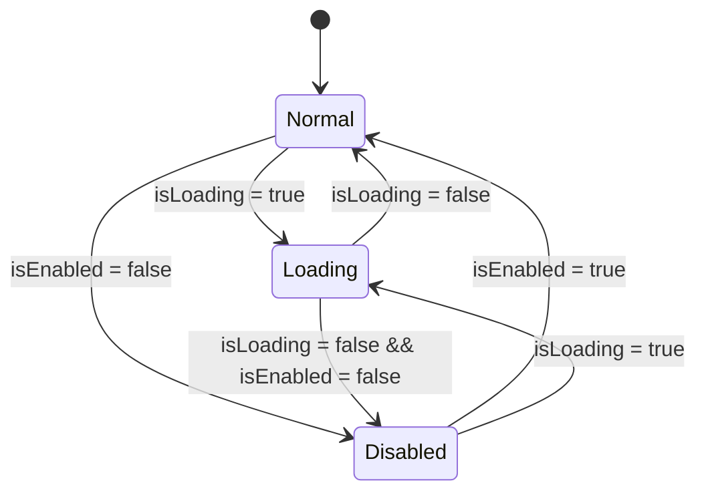
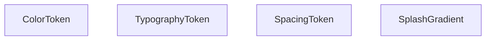

# Functional Spec — U1 `u1-design-system`

> Fase: construcción. Idioma: castellano; tokens técnicos verbatim en inglés.
> Fuente de verdad de workflows y transiciones. Vistas derivadas: ER (de entities.md) y resumen de reglas (de rules.md).

## Workflow W1 — Uso del catálogo (verificación del sistema)

1. El mantenedor abre la app en modo desarrollo y navega al catálogo.
2. El catálogo muestra las secciones en orden: Colores → Tipografía → Espaciado → Componentes.
3. El mantenedor activa el toggle de tema (claro/oscuro): todos los tokens y componentes re-renderizan con la variante correspondiente (BR1.1).
4. El mantenedor cambia el control de tamaño de texto: la tipografía y los componentes escalan (BR1.2).
5. El mantenedor compara visualmente contra el tema de Angular (verificación de fidelidad, NFR3).

## Interacción por componente

- **PrimaryButton**: estados normal/disabled/loading (BR2.1); tap ejecuta acción salvo en loading/disabled; área táctil ≥44 pt; VoiceOver rol button.
- **TextInputField**: estados normal/foco/error (BR2.2); edición de texto; toggle de visibilidad si secure; VoiceOver con label y error anunciado.
- **Card**: contenedor de superficie; sin interacción propia.
- **LoadingState / ErrorState**: presentación de estado; ErrorState combina icono + texto (no sólo color, A7).

## Máquina de estados — PrimaryButton

Texto alternativo: el botón parte de Normal; pasa a Loading cuando `isLoading` es true y vuelve a Normal al terminar; pasa a Disabled cuando `isEnabled` es false y vuelve a Normal al rehabilitarse. Precedencia cuando coinciden `isLoading` e `!isEnabled`: **Loading gana** (muestra spinner y bloquea la pulsación igualmente); al dejar de cargar con `isEnabled` aún false, queda Disabled.

## ER diagram (derivado de entities.md)

Texto alternativo: cuatro grupos de tokens independientes, sin relaciones entre sí (constantes de presentación).

## Resumen de reglas (derivado de rules.md)

BR1.1 color claro/oscuro · BR1.2 Dynamic Type · BR1.3 fallback de fuente · BR1.4 contraste · BR2.1 estados botón · BR2.2 estados campo.

## Assumptions & Open Questions

None.
