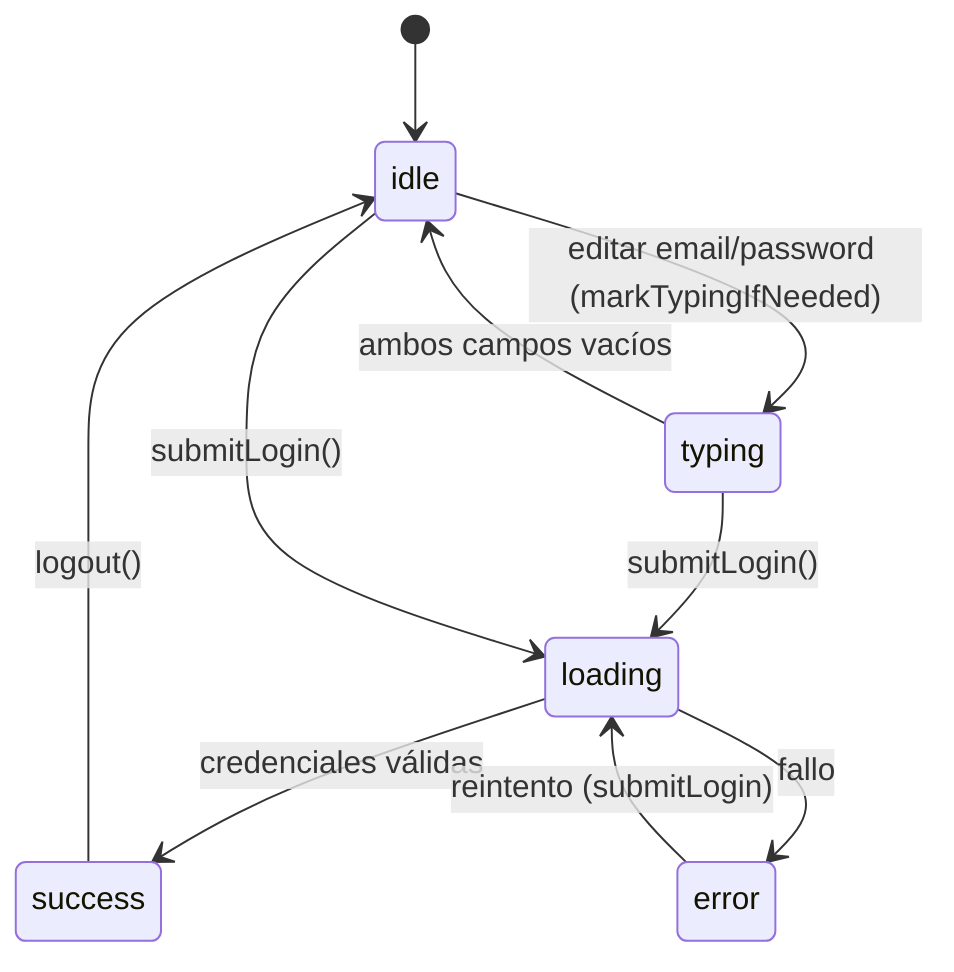

# Functional Spec — U2 `u2-login-theming`

> Fase: construcción. Idioma: castellano; tokens técnicos verbatim en inglés.
> Unit UI-only (sin entities/rules): reviste el login de F1 con el sistema de diseño de U1, SIN cambiar comportamiento ni layout. Fuente de verdad del revestimiento.

## Alcance

Sustituir la **capa visual** de `LoginView` (F1) por los componentes y tokens de U1 (`DSColor`, `DSFont`, `DSSpacing`, `PrimaryButton`, `TextInputField`, `ErrorState`, `Card`), **preservando** la lógica de `AuthViewModel` (`email`, `password`, `canSubmit`, `state`, `submitLogin()`, `logout()`, `markTypingIfNeeded()`) y la estructura de layout de F1. Revestir ≠ añadir elementos nuevos.

## Layout de F1 que se preserva (verificado contra `LoginView.swift`)

`VStack` con: logo (`sportscourt.fill`, `matchedGeometryEffect`), título "Futmondo Analytics", y una **card** (hoy `.ultraThinMaterial`, `cornerRadius 16`). **No hay fondo de gradiente** en el login de F1 — no se añade ninguno (el splash es otra superficie, fuera de U2). No hay subtítulo. Se conservan: `ShakeEffect` en error bajo Reduce Motion, `sensoryFeedback`, focus email→password, autofill/`textContentType`.

## Workflow W1 — Login revestido (comportamiento inalterado)

1. El usuario abre el login: logo + título (`DSFont.h1`) + card (componente `Card` de U1 o superficie con token `surface`, sustituyendo `.ultraThinMaterial`).
2. Email: `TextInputField` de U1 (label "Email", icono opcional, teclado email, autofill), binding a `viewModel.email`.
3. Contraseña: campo con toggle de visibilidad. Nota de contrato (ver abajo): el `TextInputField` de U1 (`isSecure`) cubre el campo secure; **el botón de visibilidad (ojo) se conserva como en F1** porque la superficie pública contratada de U1 no expone toggle de visibilidad. Binding a `viewModel.password`.
4. Botón: `PrimaryButton` de U1 "Iniciar sesión", `isEnabled = viewModel.canSubmit`, `isLoading = (state == .loading)`, acción `viewModel.submitLogin()`.
5. Error: `ErrorState` de U1 (icono + texto, no sólo color) con el mensaje de `state == .error`.
6. Éxito → navega (comportamiento de F1 intacto; `password` se limpia en el viewModel, SEC-A3).

## Equivalencia de revestimiento (antes → después)

| Elemento F1 (antes) | Componente U1 (después) | Comportamiento |
|---------------------|--------------------------|----------------|
| `TextField` Email inline | `TextInputField` (label, icono, teclado email, autofill) | idéntico (binding `viewModel.email`) |
| `SecureField`/`TextField` password + botón ojo | `TextInputField(isSecure:)` para el campo; **botón ojo conservado de F1** | idéntico (binding `viewModel.password`, toggle local) |
| `.buttonStyle(.borderedProminent)` | `PrimaryButton` (normal/disabled/loading) | idéntico (`isEnabled=canSubmit`, `isLoading`, `submitLogin`) |
| banner de error `.red` ad-hoc | `ErrorState` (icono+texto, tokens) | idéntico (muestra `message` de `.error`) |
| card `.ultraThinMaterial` | `Card` / superficie con token `surface` | mismo rol de contenedor |
| colores/tipografía implícitos | `DSColor`/`DSFont` | mismos valores vía tokens |

## Máquina de estados (heredada de AuthViewModel, sin cambios)

Texto alternativo: estados reales `idle`, `typing`, `loading`, `error(String)`, `success`. Editar los campos marca `typing` (o `idle` si quedan vacíos); `submitLogin()` pasa a `loading`; de ahí a `success` (navega, limpia password) o `error` (banner); `logout()` vuelve a `idle`. U2 no modifica estas transiciones.

## Nota de contrato U1↔U2 (toggle de visibilidad)

La superficie pública de U1 `TextInputField(label, text, icon, isSecure, errorMessage?)` NO incluye toggle de visibilidad. Para revestir sin regresión, U2 conserva el botón ojo del login de F1 (estado local `isPasswordVisible`), envolviendo el campo con el estilo de U1. Alternativa futura (fuera de alcance de este intent): ampliar `TextInputField` de U1 con una afordancia de visibilidad; se registra como posible mejora, no se hace aquí.

## No aplica

Sin entities ni rules propias (UI-only): la lógica vive en `AuthViewModel` de F1, que U2 NO modifica. Sin API de red nueva. Sin fondo de gradiente añadido.

## Assumptions & Open Questions

- [assumption] El botón de visibilidad del password se mantiene con el patrón de F1 por el límite de la superficie pública de U1; ampliar U1 queda fuera de este intent. [contract-summary]
