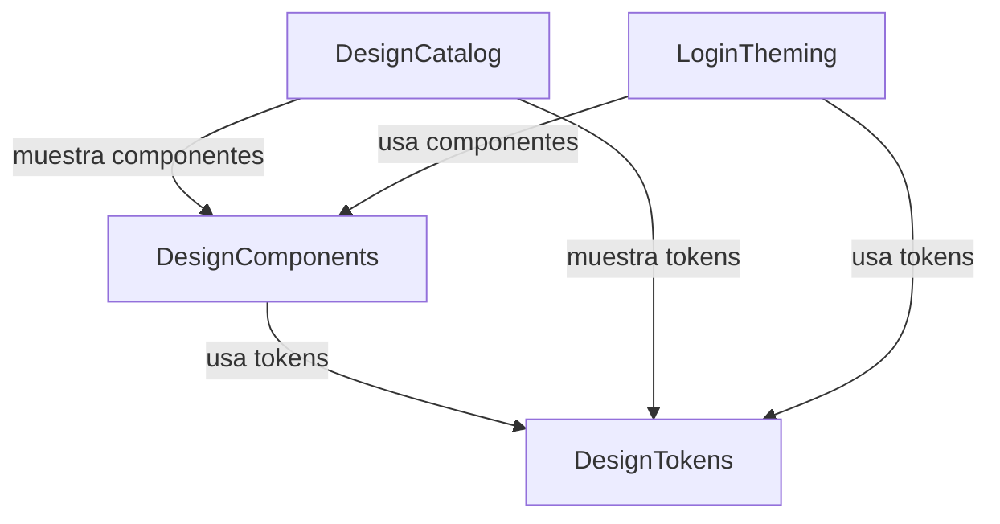

# Components — Sistema de diseño / theming nativo iOS (SwiftUI)

> Fase: inception. Idioma: castellano; tokens técnicos verbatim en inglés.
> Bloques lógicos de software (código que se escribe), no topología de despliegue. Capa de presentación SwiftUI; sin entidades de dominio persistentes.

```yaml
components:
  - name: DesignTokens
    summary: Tokens de color (claro/oscuro), tipografía (Dynamic Type) y espaciado que reproducen el tema de Angular.
    behaviour: >
      Expone Color Assets (Any/Dark Appearance) por rol (primary, tertiary, surface, onSurface,
      moneyPositive, moneyNegative, errorContainer, splash gradient), una escala tipográfica
      h1/h2/h3/body basada en Roboto con fallback a la fuente del sistema y soporte Dynamic Type,
      y una escala de espaciado xs/sm/md/lg/xl. No contiene lógica de UI; es la base consumida por el resto.
    responsibilities:
      - Definir y resolver los tokens de color claro/oscuro
      - Definir la escala tipográfica con Dynamic Type
      - Definir la escala de espaciado
    depends_on: []
    dependents:
      - component: DesignComponents
        interaction: consume tokens de color/tipografía/espaciado
      - component: DesignCatalog
        interaction: muestra los tokens
      - component: LoginTheming
        interaction: aplica tokens al login
    external_dependencies:
      - name: Apple SDK (SwiftUI)
        kind: other
        purpose: framework de UI nativo (coste 0 €)
    entities: []
  - name: DesignComponents
    summary: Componentes SwiftUI base (botón, campo de texto, tarjeta, estados de carga/error).
    behaviour: >
      Implementa PrimaryButton (normal/disabled/loading), TextInputField (label, icono, error, secure),
      Card (superficie) y LoadingState/ErrorState reutilizables. Consume DesignTokens y responde a
      claro/oscuro, Dynamic Type y VoiceOver sin estilos ad-hoc por pantalla.
    responsibilities:
      - Proveer los componentes base reutilizables con sus estados
      - Garantizar accesibilidad (contraste, Dynamic Type, VoiceOver, táctil ≥44pt)
    depends_on:
      - component: DesignTokens
        interaction: usa tokens de color/tipografía/espaciado
        style: sync
    dependents:
      - component: DesignCatalog
        interaction: muestra los componentes
      - component: LoginTheming
        interaction: reviste el login con estos componentes
    external_dependencies:
      - name: Apple SDK (SwiftUI)
        kind: other
        purpose: framework de UI nativo
    entities: []
  - name: DesignCatalog
    summary: Pantalla de catálogo/preview que exhibe tokens y componentes con toggles de tema y tamaño de texto.
    behaviour: >
      Pantalla de desarrollo con scroll por secciones (Colores, Tipografía, Espaciado, Componentes) y
      controles para alternar claro/oscuro y variar Dynamic Type, permitiendo verificar la fidelidad
      contra el tema de Angular.
    responsibilities:
      - Mostrar todos los tokens y componentes
      - Ofrecer los controles de tema y tamaño de texto
    depends_on:
      - component: DesignTokens
        interaction: muestra los tokens
        style: sync
      - component: DesignComponents
        interaction: muestra los componentes
        style: sync
    dependents: []
    external_dependencies:
      - name: Apple SDK (SwiftUI)
        kind: other
        purpose: framework de UI nativo
    entities: []
  - name: LoginTheming
    summary: Revestimiento del login de F1 con el sistema de diseño, sin cambios de comportamiento.
    behaviour: >
      Sustituye la capa visual del login existente de F1 por los componentes y tokens del sistema
      (campos, botón, estados, splash gradient) preservando la lógica funcional (login → auto-login
      Keychain → refresh → logout, validación y errores).
    responsibilities:
      - Aplicar tokens y componentes al login existente
      - Preservar el comportamiento funcional de F1 (sin regresión)
    depends_on:
      - component: DesignTokens
        interaction: usa tokens
        style: sync
      - component: DesignComponents
        interaction: usa los componentes base
        style: sync
    dependents: []
    external_dependencies:
      - name: Apple SDK (SwiftUI)
        kind: other
        purpose: framework de UI nativo
    entities: []
```

## Component Diagram



Texto alternativo del diagrama: `DesignTokens` es la base (sin dependencias). `DesignComponents` depende de `DesignTokens`. `DesignCatalog` depende de `DesignTokens` y `DesignComponents`. `LoginTheming` depende de `DesignTokens` y `DesignComponents`. Grafo acíclico.

## Component Summary

| Component | Purpose | Depends On | Dependents | Entities Owned |
|-----------|---------|------------|------------|----------------|
| DesignTokens | Tokens color/tipografía/espaciado | — | DesignComponents, DesignCatalog, LoginTheming | — |
| DesignComponents | Componentes base + estados | DesignTokens | DesignCatalog, LoginTheming | — |
| DesignCatalog | Pantalla de catálogo/preview | DesignTokens, DesignComponents | — | — |
| LoginTheming | Revestir login de F1 | DesignTokens, DesignComponents | — | — |

## Entity Ownership

Ninguna. Es una capa de presentación sin entidades de dominio persistentes (Q2=A).

## External Dependencies

| Component | Dependency | Kind | Purpose |
|-----------|------------|------|---------|
| Todos | Apple SDK (SwiftUI) | other | Framework de UI nativo, coste 0 € |

## Rationale

| Component | Por qué es un bloque separado |
|-----------|-------------------------------|
| DesignTokens | Base estable de menor ritmo de cambio; la consumen todos los demás. |
| DesignComponents | Concern distinto (comportamiento de UI + accesibilidad), depende sólo de tokens. |
| DesignCatalog | Superficie de verificación con ciclo de vida propio (herramienta de desarrollo). |
| LoginTheming | Trabajo acotado sobre código existente de F1, con riesgo de regresión propio. |

**Alternatives Rejected**: fusionar tokens + componentes en un único `DesignSystem` (Q1 opción B) — rechazado por mezclar la base estable con el comportamiento de UI y dificultar la trazabilidad FR→componente. Ver ADR-001.

## Assumptions & Open Questions

None.
