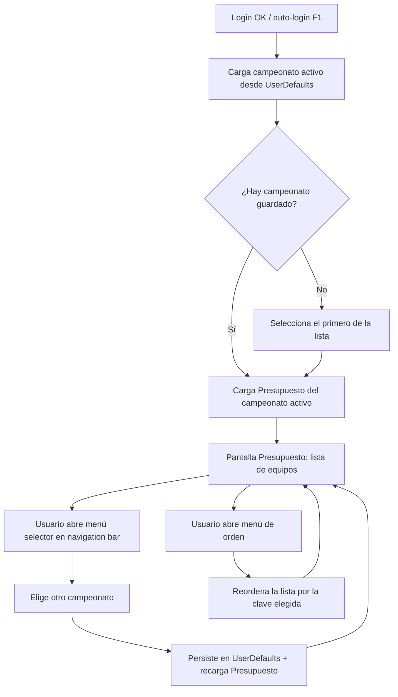

# User Flow — F2: Presupuesto nativo + selector de campeonato

> Fase: ideación (rough-mockups). Idioma: castellano; tokens técnicos verbatim en inglés.

## Flujo principal

Texto fallback: tras el login (o auto-login de F1), la app lee el campeonato activo de `UserDefaults`; si no hay, toma el primero de la lista. Carga el Presupuesto de ese campeonato y muestra la lista de equipos. Desde la navigation bar, el usuario puede (a) abrir el selector y cambiar de campeonato — se persiste y recarga —, o (b) abrir el menú de orden y reordenar la lista.

## Flujos de error

- Fallo al cargar campeonatos → la pantalla muestra error con reintento; si falla `GET /api/v1/user/championships`, se intenta `GET /api/v1/championships` (fallback como en la web).
- Fallo al cargar balances → mensaje de error + botón Reintentar; no se corrompe el estado del campeonato activo.

## Sources

- `angular-app/src/app/core/services/championship.service.ts` — lógica de selección/persistencia/fallback de endpoints.
- `aidlc/spaces/default/intents/261019-presupuesto-selector-cam/ideation/scope-definition/scope-document.md`.

## Assumptions & Open Questions

None.
