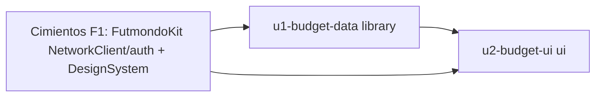

# Unit of Work — Dependencies (F2)

> Fase: inception (units-generation). Idioma: castellano; tokens técnicos verbatim en inglés.



Texto fallback: U1 (datos/lógica) depende de los cimientos de F1 (red/auth). U2 (UI) depende de U1 y del DesignSystem de F1. No hay ciclos. U1 se construye y verifica primero (`swift test`); U2 después (compila + validación en dispositivo).

## Unidades (bloque canónico)

```yaml
units:
  - name: u1-budget-data
    kind: library
    depends_on: []
  - name: u2-budget-ui
    kind: ui
    depends_on: [u1-budget-data]
```

## Orden de construcción

1. **U1 `u1-budget-data`** — sin dependencias nuevas; checkpoint `swift build && swift test`.
2. **U2 `u2-budget-ui`** — tras U1; checkpoint `swift build` + validación en dispositivo.

## Sources

- `aidlc/spaces/default/intents/261019-presupuesto-selector-cam/inception/units-generation/unit-of-work.md`

## Assumptions & Open Questions

None.
