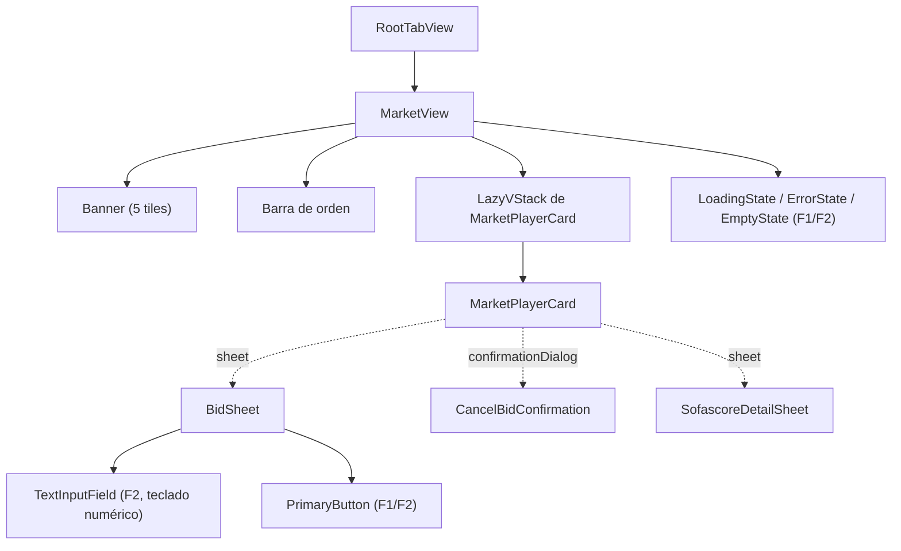

# Frontend Components — u1-market (pantalla de Mercado)

> Jerarquía de componentes SwiftUI, props/estado, flujos de interacción, reglas
> de validación de formulario y puntos de integración de la pantalla de Mercado.
> Reutiliza el `DesignSystem` de F1/F2 (tokens, `Card`, `PrimaryButton`,
> `TextInputField`, estados de carga/error) y los servicios de `FutmondoKit`.

## Sources

- `.../inception/domain-design/components.md` (V1–V7, C1–C8).
- `.../inception/refined-mockups/mockups.md` (M1–M4).
- `functional-spec.md` (workflows W1–W7).

## Jerarquía de componentes

Fallback de texto: `RootTabView` hospeda `MarketView` (2ª pestaña). `MarketView`
compone el banner (5 tiles), la barra de orden, el `LazyVStack` de
`MarketPlayerCard` y los estados loading/error/empty reutilizados de F1/F2. Cada
`MarketPlayerCard` abre, según la acción, `BidSheet` (sheet), 
`CancelBidConfirmation` (confirmationDialog) o `SofascoreDetailSheet` (sheet).
`BidSheet` usa `TextInputField` y `PrimaryButton` del DesignSystem.

## Componentes, props y estado

### V1 — `MarketView`
- **Props**: ninguna (lee `MarketViewModel` como `@StateObject`/`@ObservedObject`
  y `championshipService` del entorno).
- **Estado observado** (de `MarketViewModel`): `loadState`, `players`, `userInfo`,
  `sortField`, `isWriting`, `error`.
- **Interacción**: dispara `load()` al aparecer y vía `onChange` de
  `championshipService.activeId()`. Renderiza el estado correspondiente (W1).

### V2 — `MarketViewModel` (`@MainActor`, `ObservableObject`)
- **Estado publicado**: `loadState`, `players`, `userInfo`, `sortField`,
  `isWriting`, `error`, `lastWriteNotice` (para el aviso).
- **Acciones**: `load()`, `reload()`, `setSort(field)`, `placeBid(player, price)`,
  `cancelBid(player)`. Orquesta `MarketService` + `MarketSorter`; mapea
  `MarketWriteOutcome` a `lastWriteNotice` y decide la recarga (W6).
- **Invariante**: `isWriting` global; sólo `.accepted` llama a `reload()`.

### V3 — `MarketPlayerCard`
- **Props**: `player: MarketPlayer`, `isWriting: Bool`, callbacks
  `onBid`, `onCancel`, `onOpenSofascore`.
- **Estado**: ninguno propio (presentacional).
- **Render**: header (avatar, nombre→`sofascore_url` si existe, equipo+logo,
  badges Sofascore y %titular, chips de posición), grid de métricas (valor,
  tendencia ↗/↘+signo, precio mercado, sugerida, puntos+partidos, media),
  marca de favorito si `is_favorite`. Acción: "PUJAR {suggested_bid}" si sin puja;
  "Puja activa: {current_bid}" + cancelar si con puja. Botones deshabilitados si
  `isWriting`.

### V4 — `BidSheet`
- **Props**: `player: MarketPlayer`, `userInfo: MarketUserInfo`, callback
  `onConfirm(price)`.
- **Estado**: `bidAmount` (inicia en `suggested_bid`), `validation`
  (`BidAmountValidator` result).
- **Validación de formulario** (W4): `> 0`, `≥ market_price`,
  `≤ available_for_bids`; mensaje inline en castellano según el caso; "Pujar"
  deshabilitado si inválido o `isWriting`.

### V5 — `CancelBidConfirmation`
- **Props**: `player: MarketPlayer`, callback `onConfirm`.
- **Estado**: ninguno. `.confirmationDialog`/`.alert` con acción destructiva
  "Cancelar puja" y "No".

### V6 — `SofascoreDetailSheet`
- **Props**: `playerName: String`.
- **Estado local**: `detailState ∈ {loading, error, data, empty}` (aislado, W7);
  usa `SofascoreService`.
- **Render**: rating hero (color por tramo) + grid de ~16 stats; estados
  loading/error/empty(404) locales.

### V7 — `RootTabView` (modificación mínima)
- Añade la 2ª pestaña "Mercado" (`MarketView`) junto a "Presupuesto" (F2). Sin
  cambios en la pestaña existente.

## Puntos de integración (API, sin cambios de backend)

| Acción | Endpoint | Método | Params (query) |
|---|---|---|---|
| Cargar mercado | `/api/v1/market/today` | GET | `championship_id` |
| Pujar | `/api/v1/market/bid` | POST | `championship_id`, `player_id`, `player_slug`, `price`, `is_clause=false` |
| Cancelar | `/api/v1/market/cancelbid` | POST | `championship_id`, `bid_id` |
| Detalle Sofascore | `/api/v1/sofascore/player/{player_name}` | GET | `championship_id` |

Todas con `Authorization: Bearer <access token>` (NFR3). El transporte es
`NetworkClient` (F1, reutilizado).

## Validación de formulario (resumen)

| Campo | Regla | Mensaje (castellano) |
|---|---|---|
| importe de puja | `> 0` | "El importe debe ser mayor que 0" |
| importe de puja | `≥ market_price` | "Mínimo: {market_price}" |
| importe de puja | `≤ available_for_bids` | "Máximo disponible: {available_for_bids}" |

## Accesibilidad (NFR6)

- Significado no sólo por color: la tendencia lleva flecha + signo; Balance/
  Disponible llevan etiqueta además del color; estados de error llevan icono +
  texto.
- Etiquetas accesibles en botones de puja/cancelar y en el badge Sofascore;
  operable con VoiceOver; contraste del DesignSystem (WCAG AA vía `ContrastRatio`).
- Áreas táctiles ≥ 44pt (`PrimaryButton`).

## Assumptions & Open Questions

None.
