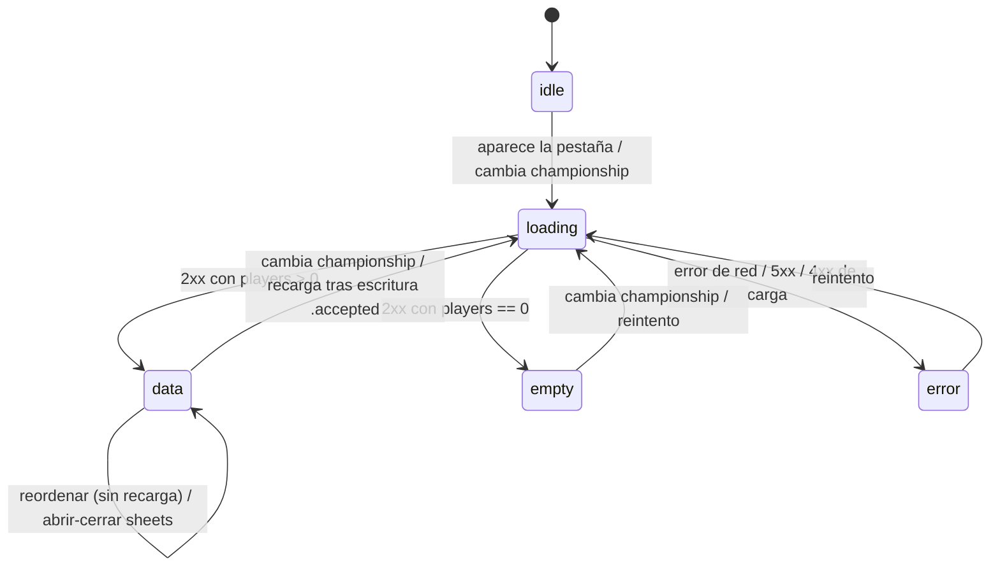
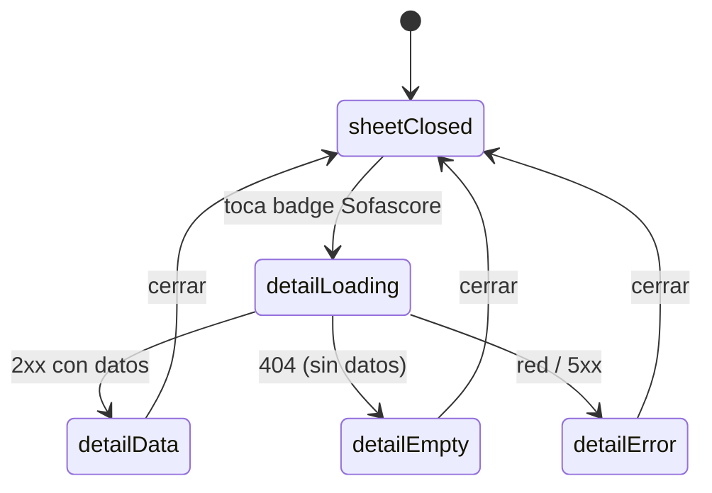

# Functional Spec — u1-market (pantalla de Mercado)

> Especificación de comportamiento de la Unit `u1-market` (kind `ui`): workflows
> y máquinas de estado de la pantalla de Mercado nativa. Técnicamente agnóstico;
> la implementación concreta (SwiftUI/`FutmondoKit`) es de Code Generation. Al
> ser UI que consume contratos backend existentes e inalterados, no hay
> `entities.md`/`rules.md` propios: el modelo de datos vive en Domain Design
> (`MarketPlayer`, `MarketUserInfo`, `SofascoreDetail`) y el backend es fuente de
> verdad de las reglas de negocio de puja.

## Sources

- `.../inception/requirements-analysis/requirements.md` (FR1–FR8, NFR1–NFR6).
- `.../inception/user-stories/stories.md` (US1–US7).
- `.../inception/units-generation/unit-of-work.md`, `unit-of-work-story-map.md`.
- `.../inception/domain-design/components.md` (C1–C8, V1–V7).
- `.../inception/refined-mockups/mockups.md` (M1–M4).
- `functional-design-questions.md` (Q1–Q6 de esta Unit).

## Máquina de estados — pantalla de Mercado

Estado observable de `MarketViewModel`: `loadState ∈ {idle, loading, error,
empty, data}`, `players: [MarketPlayer]`, `userInfo: MarketUserInfo?`,
`sortField` (default `value`), `isWriting: Bool`, `detailState` (local al sheet).

Fallback de texto: la pantalla arranca en `idle`; al aparecer o cambiar el
campeonato activo pasa a `loading`; termina en `data` (hay jugadores), `empty`
(lista vacía) o `error` (red/5xx/4xx). Desde `error` o `empty` se reintenta a
`loading`. Desde `data`, reordenar o abrir/cerrar sheets no cambia el estado de
carga; una escritura aceptada dispara una recarga (`loading`).

## Workflows

### W1 — Cargar el Mercado (FR1, FR2, US1)

1. La pantalla aparece como 2ª pestaña del `RootTabView`, o cambia
   `championshipService.activeId()`.
2. `MarketViewModel` pone `loadState = loading` y llama
   `MarketService.loadToday()` → `GET /api/v1/market/today?championship_id=<activo>`
   con `Authorization: Bearer <access token>`.
3. Al resolver:
   - `MarketTodayResponse` con `players` no vacío → `players` = ordenados por
     `MarketSorter(sortField=value, desc)`, `userInfo` seteado, `loadState = data`.
   - `players` vacío → `loadState = empty` (mensaje "No hay jugadores del
     computer…").
   - fallo (red, 5xx, o 4xx de carga) → `loadState = error` con opción de
     reintento (NO lista vacía silenciosa).
4. Una recarga **sustituye por completo** `players` y `userInfo` (no merge
   incremental). Sin auto-refresh por temporizador.

### W2 — Banner económico (FR3, US2)

1. Con `userInfo` disponible, el banner muestra: Presupuesto (`balance`), En
   pujas (`active_bids_total`), Balance (`balance − active_bids_total` vía
   `balanceMinusBids`), Puja máxima (`max_bid`), Disponible
   (`available_for_bids`).
2. Formato moneda es-ES, 0 decimales. **Balance**: verde si `≥ 0`, rojo si `< 0`.
   **Disponible**: verde si `> 0`, rojo si `≤ 0`.

### W3 — Lista y orden (FR4, FR5, US3, US4)

1. Cada jugador se renderiza como card (ver `frontend-components.md`).
2. El selector de orden ofrece 7 campos
   (`value/change/sofascore_rating/starter_pct/suggested_bid/points/average`),
   siempre **descendente**, nulos al final; default `value`.
3. Cambiar el criterio reordena la lista **ya cargada** (no recarga). El criterio
   es estado efímero de pantalla (no se persiste entre sesiones).

### W4 — Pujar (FR6, US5)

1. En una card **sin puja activa**, el botón "PUJAR {suggested_bid}" abre
   `BidSheet` con `bidAmount = suggested_bid`.
2. Validación inline vía `BidAmountValidator` contra `[market_price,
   available_for_bids]` y `> 0`:
   - vacío o `≤ 0` → `.nonPositive` ("debe ser mayor que 0").
   - `< market_price` → `.tooLow` (mensaje con el mínimo).
   - `> available_for_bids` → `.tooHigh` (mensaje con el máximo "Disponible").
   - en rango → `.valid`; botón "Pujar" habilitado.
3. Al confirmar: `isWriting = true` (deshabilita puja/cancelar en **todas** las
   cards) y `MarketService.placeBid(playerId, slug, price)` →
   `POST /api/v1/market/bid` (query `championship_id`, `player_id`, `player_slug`,
   `price`, `is_clause=false`).
4. Desenlace vía `MarketWriteOutcome` (ver W6). `isWriting = false` al terminar.

### W5 — Cancelar puja (FR7, US6)

1. En una card **con puja activa** (`current_bid`), se muestra "Puja activa:
   {current_bid}" y un botón de cancelar.
2. Cancelar abre `CancelBidConfirmation`; al confirmar: `isWriting = true` y
   `MarketService.cancelBid(current_bid_id)` → `POST /api/v1/market/cancelbid`
   (query `championship_id`, `bid_id`).
3. Desenlace vía `MarketWriteOutcome` (ver W6). `isWriting = false` al terminar.

### W6 — Desenlace de escritura (FR6.4, FR7.3)

`MarketWriteOutcome` mapea la respuesta a tres casos, y la UI reacciona:

| Caso | Condición | UI | Recarga |
|---|---|---|---|
| `.accepted` | HTTP 2xx con `success=true` | aviso de éxito | **Sí** (W1) |
| `.rejected(message)` | HTTP 2xx `success=false`, o 4xx (422 `price`/400 sin equipo) | aviso con el `message`/`detail` | No |
| `.networkError` | error de red o 5xx | aviso de error genérico | No |

Nunca bool ni nil silencioso (ADR-2). Durante la operación los botones de
escritura están deshabilitados (`isWriting`).

### W7 — Detalle Sofascore (FR8, US7)

1. Tocar el badge Sofascore de una card abre `SofascoreDetailSheet`.
2. El sheet tiene **estado local** `detailState ∈ {loading, error, data}` y usa
   `SofascoreService.loadDetail(player_name)` →
   `GET /api/v1/sofascore/player/{player_name}?championship_id=<activo>`.
3. `data` → rating hero + grid de stats. `404` → se trata como "sin datos" dentro
   del sheet (no error de pantalla). Otro fallo → estado `error` local.
4. **Aislamiento (FR8.2)**: cualquier estado del sheet es local; un fallo o
   latencia del detalle **no** afecta a `loadState` de la lista ni a `isWriting`
   ni a la capacidad de pujar.

## Reglas de negocio (fuente de verdad: backend, inalterado)

La UI **no** posee reglas de negocio nuevas; valida en cliente para UX pero el
backend es autoridad:

- **BR-UI-1** (validación cliente de importe): `price` en
  `[market_price, available_for_bids]` y `> 0` antes de habilitar "Pujar". El
  backend revalida (`price > 0`, `price ≤ 5_000_000_000`) y puede rechazar.
- **BR-UI-2** (tope efectivo): el máximo mostrado/validado es
  `available_for_bids` (= `max_bid − active_bids_total`), no `max_bid`
  (divergencia intencionada, ADR-3).
- **BR-UI-3** (recarga sólo en éxito): sólo `.accepted` recarga el Mercado;
  `.rejected`/`.networkError` no.
- **BR-UI-4** (una escritura a la vez): `isWriting` global impide escrituras
  concurrentes.
- **BR-UI-5** (aislamiento de detalle): el fallo del detalle Sofascore no degrada
  la lista ni la escritura (FR8.2).

## Seguridad (NFR3)

Toda llamada viaja con `Authorization: Bearer <access token>` (en memoria); el
refresh token permanece en Keychain; ningún material de credencial aparece en
logs ni en mensajes de error (los avisos usan el `message`/`detail` del backend o
un texto genérico, nunca el token).

## Assumptions & Open Questions

None.
