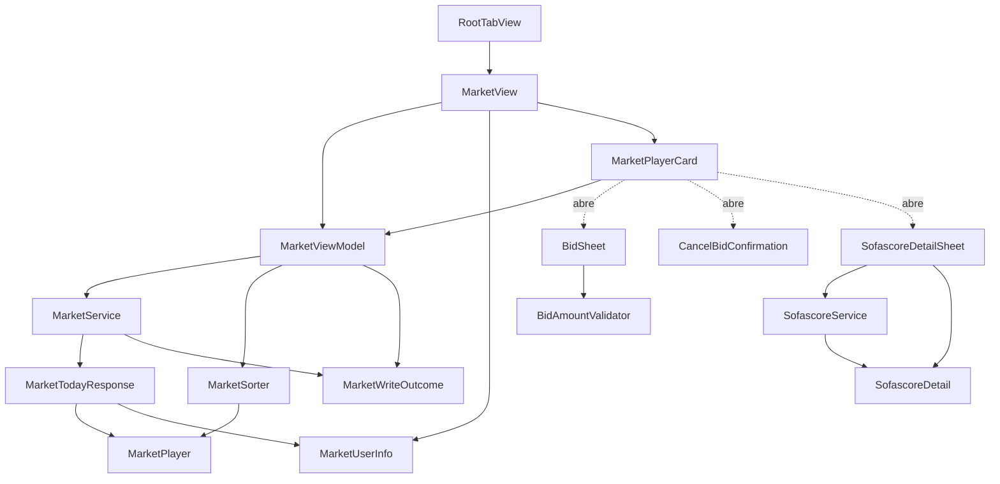

# Domain Design — Componentes (F3 Mercado)

> Diseño de componentes para la pantalla de Mercado nativa, siguiendo el patrón
> ya establecido en F2: lógica/datos en `FutmondoKit` (testeable con XCTest),
> vistas/ViewModels en `FutmondoApp` (bajo `#if canImport(SwiftUI)`, validadas en
> dispositivo). El bloque `yaml` siguiente es la **fuente de verdad**; el
> diagrama y las tablas de más abajo se derivan de él.

## Sources

- `.../inception/requirements-analysis/requirements.md` (FR1–FR8).
- `.../inception/user-stories/stories.md` (US1–US7).
- `aidlc/spaces/default/codekb/futmondo-analytics/architecture.md` y
  `component-inventory.md` (contratos `/market/*`, `/sofascore/player/*`).

## Catálogo de componentes (fuente de verdad)

```yaml
components:
  # ===== FutmondoKit (lógica/datos — testeable con XCTest) =====
  - name: MarketPlayer
    summary: Modelo de dominio de un jugador del mercado (subconjunto que consume la UI).
    behaviour: >
      Struct Codable, Equatable y Sendable. Campos opcionales modelados como
      Optional. Equatable explícito para evitar roturas de síntesis en arm64
      (regla anti-hueco-WSL). Es un value object: no tiene lifecycle propio más
      allá de la respuesta de /market/today.
    responsibilities:
      - Representar un jugador del mercado para la lista y la card
    depends_on: []
    dependents:
      - component: MarketTodayResponse
        interaction: es el elemento de la lista players
      - component: MarketSorter
        interaction: colección a ordenar
    entities:
      - name: MarketPlayer
        identifier: player_id
        attributes: [player_id, slug, name, team, team_logo, position, position2, value, market_price, change, current_bid, current_bid_id, average, points, matches, suggested_bid, sofascore_rating, sofascore_url, starter_pct, is_favorite]

  - name: MarketUserInfo
    summary: Situación económica del mánager para el banner del Mercado.
    behaviour: >
      Struct Codable, Equatable, Sendable. Expone balanceMinusBids como propiedad
      computada (balance − active_bids_total) para el banner. Value object.
    responsibilities:
      - Representar presupuesto / en pujas / balance / puja máxima / disponible
    depends_on: []
    dependents:
      - component: MarketTodayResponse
        interaction: es el campo user_info
      - component: MarketView
        interaction: datos del banner
    entities:
      - name: MarketUserInfo
        identifier: n/a (value object)
        attributes: [balance, team_value, max_bid, active_bids_total, available_for_bids]

  - name: MarketTodayResponse
    summary: DTO de la respuesta de GET /market/today.
    behaviour: >
      Struct Codable, Sendable. Agrupa la lista de jugadores y la info de usuario;
      ignora los campos del payload que la UI no consume.
    responsibilities:
      - Deserializar la respuesta de /market/today
    depends_on:
      - component: MarketPlayer
        interaction: lista players
        style: sync
      - component: MarketUserInfo
        interaction: campo user_info
        style: sync
    dependents:
      - component: MarketService
        interaction: tipo de retorno de loadToday()
    entities: []

  - name: MarketWriteOutcome
    summary: Resultado tipado de una escritura (pujar / cancelar).
    behaviour: >
      Enum .accepted | .rejected(message) | .networkError. Mapea success/message
      y los códigos HTTP (2xx success=false, 4xx, 5xx) a los tres desenlaces que
      la UI debe distinguir (FR6.4/FR7.3). Nunca un bool ni nil silencioso.
    responsibilities:
      - Expresar aceptada / rechazada-por-backend / error-de-red como tipo
    depends_on: []
    dependents:
      - component: MarketService
        interaction: tipo de retorno de placeBid()/cancelBid()
      - component: MarketViewModel
        interaction: mapea cada caso a su aviso y decide la recarga
    entities: []

  - name: MarketService
    summary: Actor que orquesta la lectura y escritura del Mercado contra el backend.
    behaviour: >
      Actor (strict concurrency Swift 6). loadToday() async throws ->
      MarketTodayResponse; placeBid(playerId, slug, price) async ->
      MarketWriteOutcome (POST /market/bid, params en query, is_clause=false);
      cancelBid(bidId) async -> MarketWriteOutcome (POST /market/cancelbid).
      Reutiliza NetworkClient y la sesión autenticada (Bearer) de F1; no retiene
      credenciales.
    responsibilities:
      - Cargar el mercado del campeonato activo
      - Ejecutar puja y cancelación y devolver el resultado tipado
    depends_on:
      - component: MarketTodayResponse
        interaction: tipo de retorno de loadToday()
        style: sync
      - component: MarketWriteOutcome
        interaction: tipo de retorno de las escrituras
        style: sync
    dependents:
      - component: MarketViewModel
        interaction: orquestación de carga/puja/cancelación
    external_dependencies:
      - name: NetworkClient (FutmondoKit, F1)
        kind: internal-component-reuse
        purpose: componente FutmondoKit existente reutilizado (transporte HTTP con Bearer); NO es un tercero ni un componente nuevo de F3
      - name: Futmondo API (vía backend /api/v1/market/*)
        kind: third-party-api
        purpose: datos del mercado y proxy de bid/cancelbid
    entities: []

  - name: MarketSorter
    summary: Función pura de ordenación de la lista de jugadores.
    behaviour: >
      Ordena [MarketPlayer] descendente por un MarketSortField
      (value/change/sofascore_rating/starter_pct/suggested_bid/points/average),
      con los nulos al final. Default value. Pura y testeable (FR5).
    responsibilities:
      - Ordenar la lista según el criterio elegido
    depends_on:
      - component: MarketPlayer
        interaction: colección a ordenar
        style: sync
    dependents:
      - component: MarketViewModel
        interaction: aplica el orden a la lista mostrada
    entities: []

  - name: BidAmountValidator
    summary: Función pura de validación del importe de puja.
    behaviour: >
      Valida el importe contra [market_price, available_for_bids] y >0; devuelve
      .valid | .tooLow | .tooHigh | .nonPositive. Pura y testeable (FR6.2).
    responsibilities:
      - Validar el importe introducido en el sheet de puja
    depends_on: []
    dependents:
      - component: BidSheet
        interaction: validación inline del campo de importe
    entities: []

  - name: SofascoreDetail
    summary: Modelo de dominio del detalle Sofascore de un jugador.
    behaviour: >
      Struct Codable, Equatable, Sendable; subconjunto del detalle de
      GET /sofascore/player/{name} que consume V6 (rating, tournament, season,
      appearances, matches_started, starter_pct, minutes_played, goals, assists,
      yellow_cards, red_cards, accurate_passes_pct, successful_dribbles,
      shots_on_target, tackles, interceptions, clean_sheets?, saves?, synced_at?).
      Value object; campos opcionales como Optional.
    responsibilities:
      - Representar las estadísticas Sofascore de un jugador para el sheet de detalle
    depends_on: []
    dependents:
      - component: SofascoreService
        interaction: producido al decodificar el detalle
      - component: SofascoreDetailSheet
        interaction: datos del rating y grid de stats
    entities:
      - name: SofascoreDetail
        identifier: player_name
        attributes: [player_name, rating, tournament, season, appearances, matches_started, starter_pct, minutes_played, goals, assists, yellow_cards, red_cards, accurate_passes_pct, successful_dribbles, shots_on_target, tackles, interceptions, clean_sheets, saves, synced_at]

  - name: SofascoreService
    summary: Actor dedicado a la carga del detalle Sofascore, aislado del Mercado.
    behaviour: >
      Actor separado de MarketService (ADR-5): loadDetail(playerName) async ->
      SofascoreDetailOutcome con resultado tipado (.loaded / .failed). Dueño
      separado para que el aislamiento de fallo (FR8.2: un error del detalle no
      afecta a la lista ni a la capacidad de pujar) sea explícito y no comparta
      estado con el servicio de Mercado. Endpoint aparte (/sofascore/player/{name},
      no /market/*).
    responsibilities:
      - Cargar el detalle Sofascore de un jugador de forma aislada
    depends_on:
      - component: SofascoreDetail
        interaction: tipo decodificado del detalle
        style: sync
    dependents:
      - component: SofascoreDetailSheet
        interaction: carga del detalle con estado local al sheet
    external_dependencies:
      - name: NetworkClient (FutmondoKit, F1)
        kind: internal-component-reuse
        purpose: componente FutmondoKit existente reutilizado (transporte HTTP con Bearer); NO es un tercero ni un componente nuevo de F3
      - name: Sofascore (vía backend /api/v1/sofascore/player/{name})
        kind: third-party-api
        purpose: estadísticas de jugador (solo lectura)
    entities: []

  # ===== FutmondoApp (UI — validada en dispositivo) =====
  - name: MarketView
    summary: Pantalla principal del Mercado (banner, orden, lista de cards).
    behaviour: >
      Estados loading/error/empty/data. Dentro de la 2ª pestaña del RootTabView.
      Reacciona al campeonato activo.
    responsibilities:
      - Componer banner + barra de orden + lista de cards y sus estados
    depends_on:
      - component: MarketViewModel
        interaction: estado y acciones de la pantalla
        style: sync
      - component: MarketUserInfo
        interaction: datos del banner
        style: sync
      - component: MarketPlayerCard
        interaction: renderiza una card por jugador de la lista
        style: sync
    dependents:
      - component: RootTabView
        interaction: contenido de la pestaña Mercado
    entities: []

  - name: MarketViewModel
    summary: ViewModel observable que orquesta el servicio y el estado de pantalla.
    behaviour: >
      @MainActor, ObservableObject. Estado observable: players, userInfo,
      sortField, isLoading, error, isWriting. Orquesta MarketService; aplica
      MarketSorter; expone acciones de puja/cancelación y el resultado para el
      aviso. isWriting es GLOBAL de pantalla (una sola escritura en vuelo;
      deshabilita puja/cancelar en todas las cards mientras dura). La recarga sólo
      se dispara en .accepted; .rejected y .networkError muestran aviso sin
      recargar.
    responsibilities:
      - Mantener el estado de la pantalla
      - Orquestar carga, puja y cancelación y mapear el resultado tipado al aviso
    depends_on:
      - component: MarketService
        interaction: carga/puja/cancelación
        style: sync
      - component: MarketSorter
        interaction: ordenación de la lista mostrada
        style: sync
      - component: MarketWriteOutcome
        interaction: decide aviso y recarga según el caso
        style: sync
    dependents:
      - component: MarketView
        interaction: fuente del estado y acciones
      - component: MarketPlayerCard
        interaction: recibe callbacks de puja/cancelar
    entities: []

  - name: MarketPlayerCard
    summary: Card de un jugador con header, grid de métricas y acción.
    behaviour: >
      NeonGlassCard con header + grid + acción (PUJAR / fila "Puja activa" +
      cancelar). Recibe el MarketPlayer y callbacks. Marca de favorito si
      is_favorite; tendencia con flecha y signo.
    responsibilities:
      - Mostrar un jugador y disparar las acciones de puja/cancelación
    depends_on:
      - component: MarketViewModel
        interaction: callbacks de puja/cancelar y estado isWriting
        style: sync
      - component: BidSheet
        interaction: abre el sheet de puja desde la acción PUJAR
        style: sync
      - component: CancelBidConfirmation
        interaction: abre la confirmación desde la acción cancelar
        style: sync
      - component: SofascoreDetailSheet
        interaction: abre el sheet de detalle desde el badge Sofascore
        style: sync
    dependents:
      - component: MarketView
        interaction: elemento de la lista
    entities: []

  - name: BidSheet
    summary: Sheet de puja con validación inline.
    behaviour: >
      Importe por defecto = suggested_bid; tiles de límite (market_price /
      available_for_bids); validación inline vía BidAmountValidator; botón "Pujar"
      deshabilitado si inválido.
    responsibilities:
      - Capturar y validar el importe de puja antes de confirmar
    depends_on:
      - component: BidAmountValidator
        interaction: validación inline del importe
        style: sync
    dependents:
      - component: MarketPlayerCard
        interaction: se abre desde la acción PUJAR
    entities: []

  - name: CancelBidConfirmation
    summary: Confirmación de cancelación de puja.
    behaviour: >
      .confirmationDialog/.alert de cancelación antes de llamar a cancelBid.
    responsibilities:
      - Confirmar la cancelación de una puja activa
    depends_on: []
    dependents:
      - component: MarketPlayerCard
        interaction: se abre desde la acción cancelar
    entities: []

  - name: SofascoreDetailSheet
    summary: Sheet con rating + grid de estadísticas Sofascore.
    behaviour: >
      Estados loading/error/data. Consume SofascoreService con estado LOCAL al
      sheet, aislado de la lista y de la escritura (FR8.2).
    responsibilities:
      - Mostrar el detalle Sofascore de un jugador sin afectar al Mercado
    depends_on:
      - component: SofascoreService
        interaction: carga del detalle
        style: sync
      - component: SofascoreDetail
        interaction: datos mostrados
        style: sync
    dependents:
      - component: MarketPlayerCard
        interaction: se abre desde el badge Sofascore
    entities: []

  - name: RootTabView
    summary: Shell de pestañas; F3 añade la 2ª pestaña "Mercado".
    behaviour: >
      Modificación mínima del shell existente: añade la pestaña "Mercado" junto a
      "Presupuesto" (F2) sin romper la navegación existente.
    responsibilities:
      - Hospedar la pestaña Mercado junto a la de Presupuesto
    depends_on:
      - component: MarketView
        interaction: contenido de la pestaña Mercado
        style: sync
    dependents: []
    entities: []
```

## Component Diagram



Fallback de texto: `RootTabView` contiene `MarketView`, que usa `MarketViewModel`
y muestra el banner (`MarketUserInfo`). `MarketViewModel` orquesta `MarketService`
(que devuelve `MarketTodayResponse` → `MarketPlayer` + `MarketUserInfo`, y
`MarketWriteOutcome` en las escrituras), aplica `MarketSorter` sobre
`MarketPlayer` y mapea `MarketWriteOutcome` al aviso. `MarketPlayerCard` recibe
callbacks del ViewModel y abre `BidSheet` (que valida con `BidAmountValidator`),
`CancelBidConfirmation` y `SofascoreDetailSheet` (que consume `SofascoreService`
→ `SofascoreDetail`, aislado del Mercado).

## Component Summary

| Component | Purpose | Depends On | Dependents | Entities Owned |
|---|---|---|---|---|
| MarketPlayer | Jugador del mercado (modelo) | — | MarketTodayResponse, MarketSorter | MarketPlayer |
| MarketUserInfo | Situación económica (banner) | — | MarketTodayResponse, MarketView | MarketUserInfo |
| MarketTodayResponse | DTO de /market/today | MarketPlayer, MarketUserInfo | MarketService | — |
| MarketWriteOutcome | Resultado tipado de escritura | — | MarketService, MarketViewModel | — |
| MarketService | Actor lectura/escritura Mercado | MarketTodayResponse, MarketWriteOutcome | MarketViewModel | — |
| MarketSorter | Ordenación pura | MarketPlayer | MarketViewModel | — |
| BidAmountValidator | Validación pura de importe | — | BidSheet | — |
| SofascoreDetail | Detalle Sofascore (modelo) | — | SofascoreService, SofascoreDetailSheet | SofascoreDetail |
| SofascoreService | Actor dedicado del detalle (aislado) | SofascoreDetail | SofascoreDetailSheet | — |
| MarketView | Pantalla del Mercado | MarketViewModel, MarketUserInfo, MarketPlayerCard | RootTabView | — |
| MarketViewModel | ViewModel/orquestación | MarketService, MarketSorter, MarketWriteOutcome | MarketView, MarketPlayerCard | — |
| MarketPlayerCard | Card de jugador + acciones | MarketViewModel, BidSheet, CancelBidConfirmation, SofascoreDetailSheet | MarketView | — |
| BidSheet | Sheet de puja validado | BidAmountValidator | MarketPlayerCard | — |
| CancelBidConfirmation | Confirmación de cancelación | — | MarketPlayerCard | — |
| SofascoreDetailSheet | Sheet de detalle Sofascore | SofascoreService, SofascoreDetail | MarketPlayerCard | — |
| RootTabView | Shell de pestañas (2ª = Mercado) | MarketView | — | — |

## Entity Ownership

| Entity | Owning Component | Identifier | Attributes | References |
|---|---|---|---|---|
| MarketPlayer | MarketPlayer | player_id | player_id, slug, name, team, team_logo, position, position2, value, market_price, change, current_bid, current_bid_id, average, points, matches, suggested_bid, sofascore_rating, sofascore_url, starter_pct, is_favorite | — |
| MarketUserInfo | MarketUserInfo | n/a (value object) | balance, team_value, max_bid, active_bids_total, available_for_bids | — |
| SofascoreDetail | SofascoreDetail | player_name | player_name, rating, tournament, season, appearances, matches_started, starter_pct, minutes_played, goals, assists, yellow_cards, red_cards, accurate_passes_pct, successful_dribbles, shots_on_target, tackles, interceptions, clean_sheets, saves, synced_at | — |

> Cada entidad tiene **exactamente un** componente dueño. `MarketPlayer` y
> `SofascoreDetail` son value objects del dominio con dueño propio; los DTOs de
> respuesta (`MarketTodayResponse`) y los servicios/vistas no poseen entidades.

## External Dependencies

| Component | Dependency | Kind | Purpose |
|---|---|---|---|
| MarketService | NetworkClient (FutmondoKit, F1) | internal-component-reuse | Componente interno reutilizado (transporte HTTP con Bearer); no es un tercero |
| MarketService | Futmondo API (vía backend /api/v1/market/*) | third-party-api | Datos del mercado y proxy de bid/cancelbid |
| SofascoreService | NetworkClient (FutmondoKit, F1) | internal-component-reuse | Componente interno reutilizado (transporte HTTP con Bearer); no es un tercero |
| SofascoreService | Sofascore (vía backend /api/v1/sofascore/player/{name}) | third-party-api | Estadísticas de jugador (solo lectura) |

> `NetworkClient` es un componente `FutmondoKit` existente (F1) **reutilizado**,
> no una dependencia de terceros; se distingue de las APIs reales de terceros
> (`Futmondo API`, `Sofascore`), que son los únicos servicios externos de red.

## Rationale

| Component | Por qué es un building block propio |
|---|---|
| MarketPlayer | Entidad de dominio con shape propio; distinta lifecycle/concern que la UI; testeable |
| MarketUserInfo | Concern distinto (economía del banner) y value object con su propia computación |
| MarketTodayResponse | Frontera de deserialización del endpoint; aísla el shape de wire del dominio |
| MarketWriteOutcome | Concern distinto: expresar los 3 desenlaces de escritura como tipo (ADR-2) |
| MarketService | Dueño de la interacción de red del Mercado; actor con su propio aislamiento de concurrencia |
| MarketSorter | Lógica pura con change rate propio (criterios de orden); testeable aislada (FR5) |
| BidAmountValidator | Lógica pura de validación con reglas propias; testeable aislada (FR6.2) |
| SofascoreDetail | Entidad de dominio de un endpoint distinto; dueño único de su shape (R-03) |
| SofascoreService | Aislamiento de fallo explícito (FR8.2, ADR-5): endpoint y estado separados del Mercado (R-03) |
| MarketView | Composición de UI con estados propios; validada en dispositivo |
| MarketViewModel | Orquestación/estado de pantalla separado de la vista (patrón F2) |
| MarketPlayerCard | Unidad de UI reutilizable por fila con callbacks |
| BidSheet | Flujo de UI con su propio ciclo de validación |
| CancelBidConfirmation | Interacción de confirmación aislada |
| SofascoreDetailSheet | UI de detalle con estado local aislado (FR8.2) |
| RootTabView | Shell de navegación; cambio mínimo aditivo sobre F2 |

**Alternatives Rejected** (resumen; detalle en `decisions.md`):

- Poner la lógica en las vistas SwiftUI — no testeable en WSL (ADR-1).
- Señalar la escritura con `Bool`/`nil` — pierde el message/estado (ADR-2).
- Usar `max_bid` como tope de puja — permitiría pujas que el backend rechazaría
  por falta de disponible (ADR-3).
- Meter la carga de Sofascore en `MarketService` — acopla dos endpoints de
  routers distintos y arriesga el aislamiento de fallo FR8.2 (ADR-5); por eso
  `SofascoreDetail` y `SofascoreService` son componentes separados (R-03).

## Assumptions & Open Questions

None.
