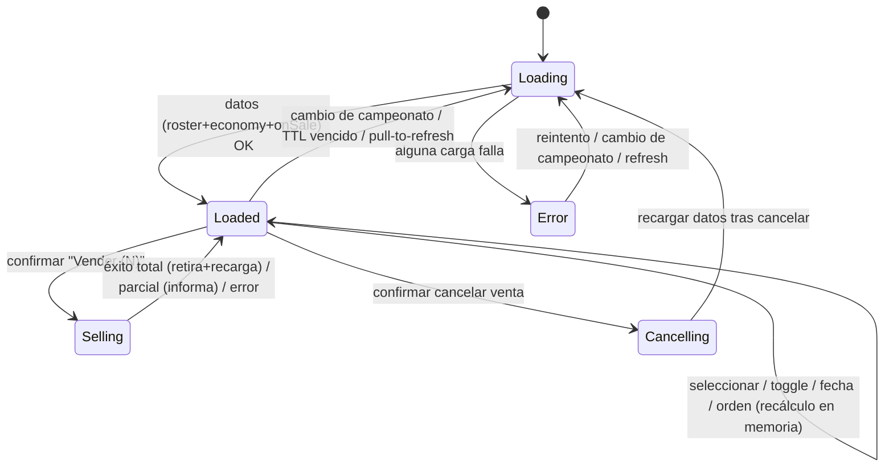
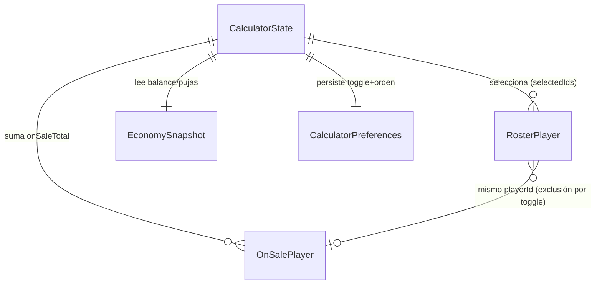

# Functional Spec — Calculadora nativa iOS

Fuente de verdad de **workflows** y **transiciones de estado**. Las vistas de
entidades (diagrama ER) y de reglas son **derivadas** (ver `entities.md` /
`rules.md`).

## Workflows

### W1 — Abrir la Calculadora y ver el resumen

1. La pestaña Calculadora aparece → `.task` llama a `loadIfNeeded()` (BR11.1).
2. Si hace falta cargar, el view model pide en paralelo (BR11.1):
   roster (`fetchRoster`), mercado (`loadToday`, para `EconomySnapshot`),
   en venta (`fetchOnSale`).
3. Mientras tanto, estado de carga; si alguna falla, estado de error legible
   (FR1.2).
4. Con datos, se compone la lista seleccionable según `includeOnSale` (BR5.2) y
   se calcula el resumen: Saldo actual, En venta (BR2.2), Pujas activas si N>0
   (BR6.2), Seleccionadas (BR2.1), Saldo futuro (BR3.1).
5. Marcar frescura en éxito.

### W2 — Seleccionar jugadores y ver el saldo futuro

1. Tap en una card → alterna `playerId` en `selectedIds` (FR6.1).
2. Recalcular `selectedTotal` (BR2.1) y `futureBalance` (BR3.1).
3. Si `selectedIds` no vacío → aparece el botón flotante "Vender (N)" (BR8.1).

### W3 — Proyectar a una fecha

1. Elegir fecha en el `DatePicker` (acotado a hoy o después, FR4.1).
2. Derivar `daysAhead` (BR1.2).
3. Recalcular valor proyectado por jugador (BR1.1), `selectedTotal` y
   `futureBalance`; actualizar etiqueta "Hoy / N días a futuro" (FR4.4).

### W4 — Cambiar el toggle "Incorporar jugadores en venta"

1. Cambiar el toggle → persistir en `UserDefaults` (BR5.1).
2. Si pasa a ON: filtrar de `selectedIds` los ids en venta (BR4.2).
3. Recomponer la lista seleccionable en memoria (BR5.2) y recalcular resumen.
4. Mostrar/ocultar la sección de cards en venta; el ítem "En venta" de la
   cabecera permanece siempre (BR6.1).

### W5 — Poner a la venta

1. Pulsar "Vender (N)" con `selectedIds` no vacío (BR8.1).
2. Confirmación nativa (BR8.1). Si se cancela, no-op.
3. Al confirmar → `sell(championshipId, ids)`; estado "vendiendo".
4. Resultado (`SellOutcome`, BR8.2):
   - **total(sold)** (`sold == total`): retirar vendidos de roster+selectable,
     limpiar `selectedIds`, recargar en venta, mostrar éxito; invalidar cachés
     (BR10.1).
   - **partial(sold,total)**: mostrar "sold/total", NO retirar, NO recargar.
   - **none(total)**: informar el fallo; sin cambios de lista.
   - **networkError(message)**: mensaje legible.

### W6 — Cancelar venta

1. En una card de la sección en venta, pulsar cancelar (BR9.1).
2. Confirmación; si se cancela, no-op.
3. Al confirmar → `cancelSale(championshipId, playerId)`; recargar datos;
   invalidar cachés (BR10.1); error legible si falla.

### W7 — Ordenar

1. Elegir criterio en el `Menu` (valor proyectado / valor / tendencia /
   plusvalía) → persistir (BR5.1).
2. Reordenar la lista descendente por el criterio (plusvalía = `profit`, BR7.1).

## State machine — pantalla Calculadora

## Derived — Entity-Relationship (ver `entities.md`, fuente de verdad)

## Derived — Rules summary (ver `rules.md`, fuente de verdad)

| Área | Reglas |
|---|---|
| Proyección / totales / saldo futuro | BR1.1–BR1.2, BR2.1–BR2.2, BR3.1–BR3.2 |
| Anti-doble-conteo | BR4.1–BR4.2 |
| Preferencias / cabecera / plusvalía | BR5.1–BR5.2, BR6.1–BR6.2, BR7.1 |
| Escritura (venta/cancelación) + coherencia | BR8.1–BR8.2, BR9.1, BR10.1 |
| Carga/frescura | BR11.1 |
