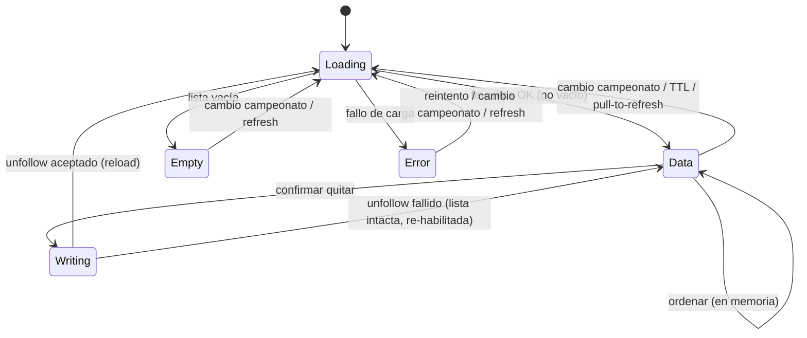
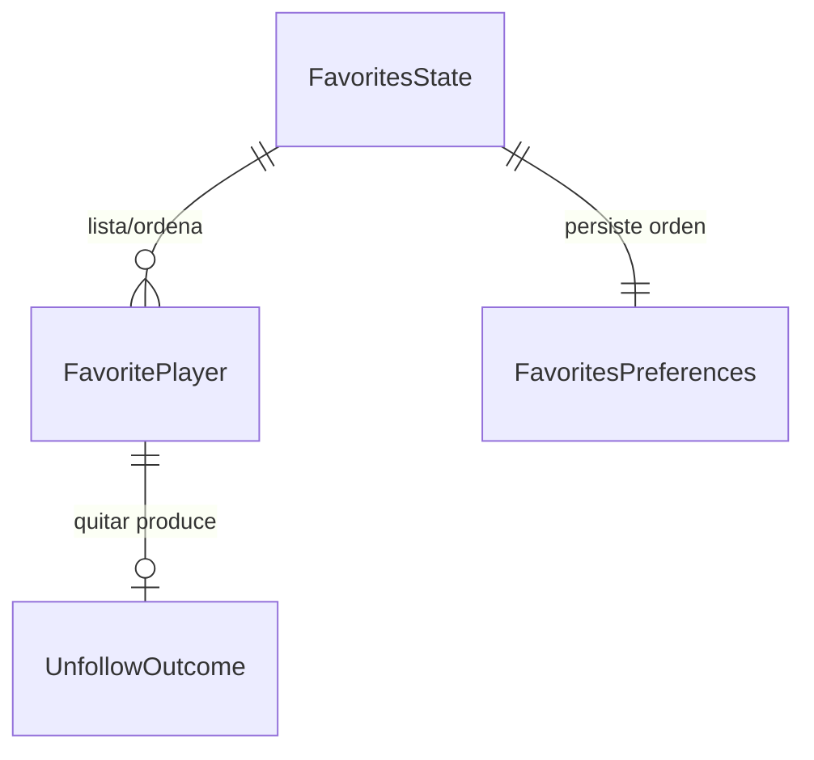

# Functional Spec — Favoritos nativa iOS

Fuente de verdad de **workflows** y **transiciones de estado**. Las vistas de
entidades y reglas son **derivadas** (ver `entities.md` / `rules.md`).

## Workflows

### W1 — Abrir Favoritos
1. La pestaña aparece → `.task` → `loadIfNeeded()` (BR1.1).
2. Si hace falta, `fetchFavorites(championshipId)`; estado de carga.
3. Con datos: ordenar (BR4.1) y mostrar cards + recuento; si vacío → estado
   vacío (BR2.1); si error → mensaje + reintentar.
4. Marcar frescura en éxito.

### W2 — Cambiar de campeonato
1. `onChange(budgetViewModel.activeChampionship?.championshipId)` (BR1.2) →
   `load()` (recarga dura).

### W3 — Ordenar
1. Elegir criterio en el `Menu` → persistir (BR4.1) → reordenar en memoria.

### W4 — Quitar de favoritos
1. Pulsar "Quitar" en la card → `ConfirmSheet` (BR5.1). Si se cancela, no-op.
2. Al confirmar → `unfollow(championshipId, playerId)`; `isWriting` (BR5.3).
3. Resultado (`MarketWriteOutcome`):
   - **accepted**: aviso éxito + `reload()` (el jugador desaparece) (BR5.2).
   - **rejected / networkError**: aviso error, **lista intacta**, `isWriting =
     false` (acción re-habilitada) (BR5.4).

### W5 — Sofascore
1. Menú "…" por card: "Ver perfil Sofascore" (si hay URL → abre web); "Ver
   estadísticas" (hoja de detalle por nombre, componente de Mercado) (BR6.1).

## State machine — pantalla Favoritos

## Derived — Entity-Relationship (ver `entities.md`)

## Derived — Rules summary (ver `rules.md`)

| Área | Reglas |
|---|---|
| Carga/frescura + campeonato | BR1.1, BR1.2 |
| Estado vacío | BR2.1 |
| Presentación (nulos/cero, media, rating) | BR3.1–BR3.3 |
| Orden | BR4.1 |
| Quitar (confirmación, éxito, guardia, fallo) | BR5.1–BR5.4 |
| Sofascore / navegación | BR6.1, BR7.1 |
