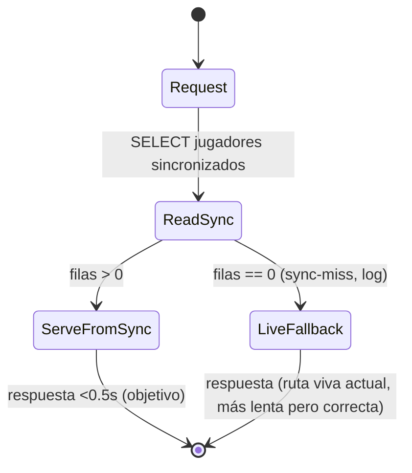

# Functional Spec — Optimización de latencia de market/today y favorites/my

Fuente de verdad de **workflows** y **decisiones**. Diagramas ER/reglas son
derivados (`entities.md`/`rules.md`).

> **Nota de alcance (verificada en código).** La gran ganancia de latencia está
> en `favorites/my` (~3.4s): hoy descarga el catálogo COMPLETO de jugadores en
> vivo (`get_championship_players`) sólo para filtrar los favoritos; el diseño lo
> sustituye por lectura desde sync. En `market/today` (~1.6s) el catálogo ya sale
> de caché; la única llamada viva que queda (`POST /1/market/players`, pujas del
> usuario) **no es sincronizable sin cambio de esquema** (las pujas no se
> persisten en Neon — verificado) y el contrato las exige, así que se mantiene.
> Es una llamada pequeña y targeted, no la descarga del catálogo. La ganancia de
> `market/today` es, por tanto, acotada y depende de esa llamada; la de
> `favorites/my` es la principal.

## Workflows

### W1 — `GET /api/v1/favorites/my` (desde sync)
1. `SELECT player_id FROM player_favorites WHERE championship_id, user_id`
   (barato). Si vacío → `{success, players: [], total: 0}` (como hoy).
2. **FavoritesReader** (capa nueva): `SELECT` de
   `player_championship_stats JOIN players LEFT JOIN sofascore_cache` filtrando
   por los `fav_ids` y free-agent (BR2.1).
3. `has_synced` = ¿devolvió filas? (BR3.1)
   - **Sí** → mapear al contrato (campos actuales), ordenar `position_order` asc,
     `value` desc (BR2.2) → responder. SIN llamada viva.
   - **No** (0 filas, campeonato no sincronizado) → **fallback** a la ruta viva
     actual (`get_championship_players` + enriquecido) + `log` (BR3.1/FR4.2).
4. Contrato de respuesta idéntico (BR6.1).

### W2 — `GET /api/v1/market/today` (catálogo desde sync, pujas en vivo)
1. **MarketReader**: catálogo desde `market_today` (cacheado) para el
   campeonato; si 0 filas → fallback a ruta viva + log (BR3.1).
2. **Pujas del usuario** (`UserBidsState`): **una** llamada viva targeted
   `POST /1/market/players` (sólo las pujas del usuario). VERIFICADO: no existen
   en Neon (la caché las elimina por privacidad, no hay tabla de pujas), así que
   esta llamada es irreducible sin cambio de esquema (fuera de alcance). Es una
   llamada pequeña, NO la descarga del catálogo completo — el coste pesado era la
   descarga del catálogo, no esta (BR4.1). Si falla con catálogo disponible →
   pujas degradadas a cero + log, nunca se falla la respuesta (BR3.2).
3. `user_info`: la parte no ligada a pujas (balance, team_value, max_bid) desde
   BD; `active_bids_total`/`count` y `available_for_bids = max_bid −
   active_bids_total` desde las pujas vivas → siempre coherente (BR5.1).
4. Responder con el contrato actual, incluidos `current_bid`/`current_bid_id`
   por jugador (BR6.1).

### W3 — Tras `POST /market/bid` o `POST /market/cancelbid`
1. La operación escribe contra Futmondo (como hoy).
2. La siguiente lectura de `market/today` vuelve a pedir las pujas en vivo a
   Futmondo (fuente autoritativa, sin caché de pujas) → refleja la operación por
   construcción, sin version-skew (BR4.2/BR5.1).

## Decisión de fallback (state machine)



## Flujo de datos (derivado — ver `entities.md`)

```mermaid
flowchart LR
    R1[favorites.py router] --> FR[FavoritesReader (capa nueva)]
    R2[market.py router] --> MR[MarketReader (capa nueva)]
    FR --> N[(Neon: players, player_championship_stats, sofascore_cache, player_favorites)]
    MR --> N2[(Neon: market_today, team_standings, transactions, team_prizes)]
    MR --> BIDS[POST /1/market/players (pujas del usuario, viva targeted - irreducible)]
    FR -. sync-miss catalogo .-> LV[Ruta viva Futmondo (fallback)]
    MR -. sync-miss catalogo .-> LV
```

## Rules summary (derivado — ver `rules.md`)

| Área | Reglas |
|---|---|
| Capa de lectura (sin god-files) | BR1.1 |
| favorites desde sync + orden | BR2.1, BR2.2 |
| fallback sync-miss + fallo de pujas degradado | BR3.1, BR3.2 |
| market catálogo desde sync + pujas en vivo | BR4.1, BR4.2 |
| user_info coherente | BR5.1 |
| contrato intacto / errores tipados | BR6.1, BR7.1 |
