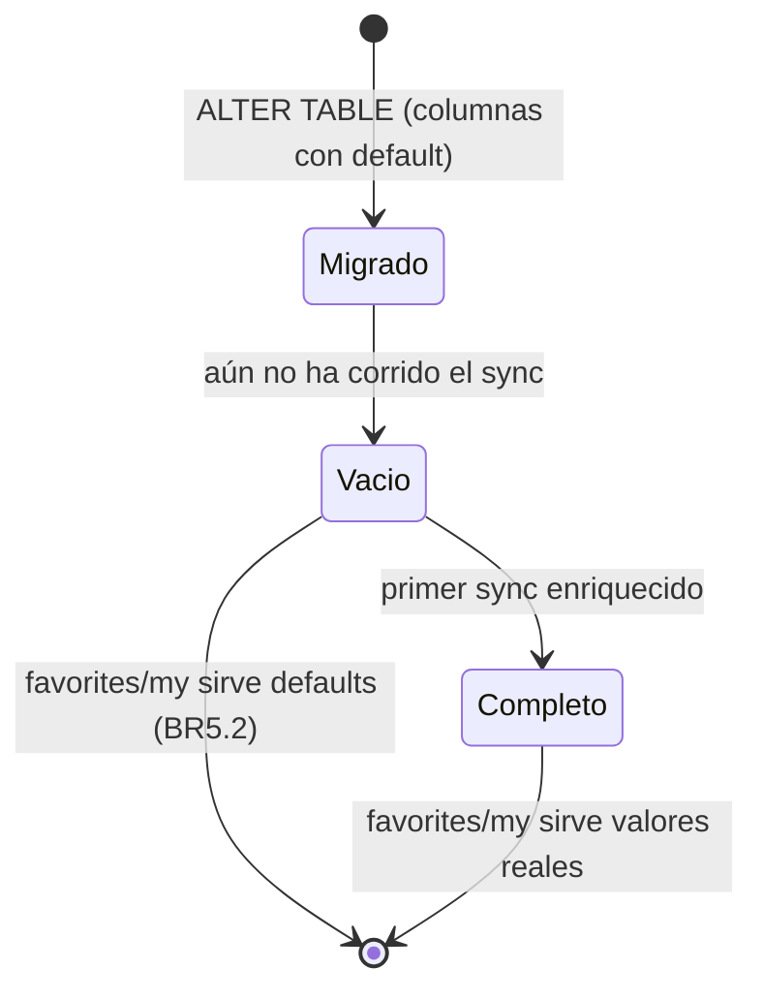

# Functional Spec — Enriquecimiento del sync de jugadores

Fuente de verdad de workflows y decisiones. Diagramas/reglas derivados
(`entities.md`/`rules.md`).

## Workflows

### W1 — Migración de esquema (idempotente, arranque)
1. En el punto de evolución de esquema existente (`schema_lifecycle` /
   `_ensure_schema_updates`), ejecutar `ALTER TABLE players ADD COLUMN IF NOT
   EXISTS` para `points`, `change`, `home_average`, `away_average`, `matches`,
   `status` (BR2.1/BR2.2). No destructivo, idempotente (NFR6).
2. Sin backfill: las columnas quedan con su default hasta el primer sync (BR5.2).

### W2 — Sync de jugadores enriquecido
1. `PlayersFullSyncOrchestrator.sync()` obtiene el catálogo
   (`get_championship_players`) como hoy.
2. Para cada jugador, además de lo actual, añade a `player_records`:
   `points`, `change`, `home_average=norm(...)`, `away_average=norm(...)`,
   `matches`, `status` (BR1.1/BR1.2).
3. `save_players_batch` upserta esas columnas (BR2.1).
4. El resto (stats, orphan cleanup, favorites, metadata) **no cambia**; el
   `SyncResult` se preserva byte-a-byte.

### W3 — `GET /api/v1/favorites/my` (desde sync completo)
1. `favorites_read` lee los favoritos free-agent desde `players` JOIN
   `player_championship_stats` (owner nulo), ahora seleccionando también
   `points`, `change`, `home_average`, `away_average`, `matches`, `status`
   (BR4.1).
2. Resuelve `team`/`team_logo` desde `real_team_id` con `LALIGA_TEAMS` (fallback
   `real_team_name`; peor caso `''`/`''`) (BR3.1).
3. Mapea al contrato con los defaults de BR5.2 cuando una columna aún esté nula
   (primer sync pendiente); orden `position_order` asc, `value` desc (BR4.2).
4. Enriquecimiento sofascore igual que hoy. `market_today` deja de ser necesario
   para estos campos.

## Flujo de datos (derivado)

```mermaid
flowchart LR
    FUT[/5/league/championshipplayers] --> ORCH[PlayersFullSyncOrchestrator]
    ORCH -->|player_records + nuevos campos| ADP[players_adapter upsert]
    ADP --> PL[(players: +points,change,home_average,away_average,matches,status)]
    R[favorites.py router] --> FR[favorites_read]
    FR --> PL
    FR --> PCS[(player_championship_stats: free-agent)]
    FR --> SC[(sofascore_cache)]
    FR --> LT[LALIGA_TEAMS mapa estatico -> team/logo]
```

## Estado de los campos antes/después del primer sync



## Rules summary (derivado)

| Área | Reglas |
|---|---|
| Extracción + normalización | BR1.1, BR1.2 |
| Esquema idempotente sin god-files | BR2.1, BR2.2 |
| Equipo/escudo por teamId | BR3.1 |
| favorites_read desde sync + contrato intacto | BR4.1, BR4.2 |
| characterization-first + defaults + sin credenciales | BR5.1, BR5.2, BR5.3 |
